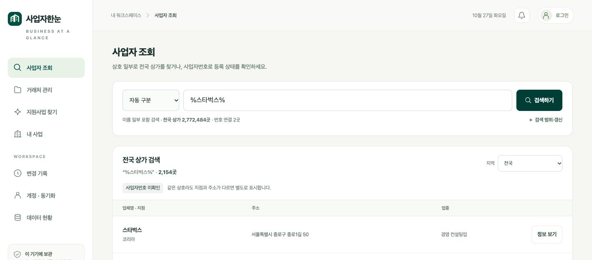
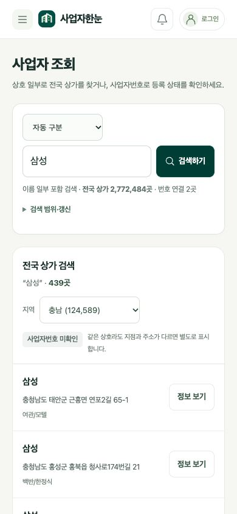
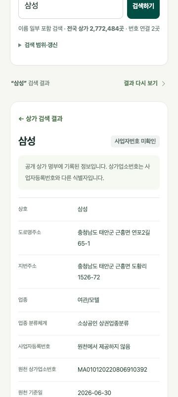

# 사업자한눈 v0.6 운영 배포 검증

2026-10-27 한국시간 검증. PR #2를 main에 병합하고 전국 상가 자료를 생성·검증한 뒤 GitHub Pages에 배포했다. 검색 제목에 키보드 초점이 있을 때 진행률 갱신이 멈추던 부분도 보완해 재배포했다.

- 운영: https://softm.github.io/bizhannun/#lookup
- 데이터 현황: https://softm.github.io/bizhannun/data-status.html
- 최종 배포: https://github.com/softm/bizhannun/actions/runs/40372933008
- 최종 배포 완료: 2026-10-27 02:57:44 KST
- 동작 코드: 8f773c42be2a7a1a88c15b4960e84b6ae40994cb
- 배포 수집본 커밋: b940a7f3db43d8f798c6e4d0aa496ee018d16e62

| 운영 브라우저 확인 | 결과 |
|---|---|
| 검색 대상 표시 | 전국 상가 2,772,484곳 / 번호 연결 2곳 |
| 스타벅스 | 2,154곳 |
| %스타벅스% | 2,154곳 |
| %스타벅스% + 충남 | 54곳, 충남 주소 표시 |
| 삼성 + 충남 (모바일) | 439곳 |
| 상세 보기·결과 복귀 | 동일 검색어와 결과 유지, 상가 ID와 사업자번호 구분 |
| 진행률 | 제목에 초점이 있어도 7%·현재 305곳 확인 등 중간 진행 갱신 |
| 검색 중 지역 변경 | 진행 중 전국 검색에서 충남 검색으로 전환, 새 결과 439곳 표시 |
| 모바일 목록 | 390px 화면, 문서 너비·스크롤 너비 모두 390px |
| 모바일 상세 | 360px 화면, 문서 너비·스크롤 너비 모두 360px |
| 콘솔 | 검수 탭 오류 0건 |

자동 검증은 JavaScript 371개 통과·실패 0개·Firestore 에뮬레이터 검사 1개 건너뜀, Python 5개 통과다. 최종 GitHub 작업에서도 검사·테스트·전체 파일 검증·빌드·배포가 성공했다.

수집 현황에서 원천 기준일 2026-06-30, 마지막 실제 자료 수집 2026-10-27 02:48, 마지막 원천 확인 시도 02:55, 매일 06:17 한국시간 새 원본 확인 예약을 확인했다. 현재 원본 구성은 전남광주 코드 12를 포함한 16개 지역이다. 원본 2,772,484행과 수록 건수가 같고 제외·중복은 각 0행이다.

상가 명부에는 사업자등록번호가 없다. 상가 결과에서 같은 이름의 사업자번호를 임의로 연결하지 않으며, 국세청 상태 확인은 번호를 입력한 별도 조회로 제공한다. 결과가 많은 검색은 전체 일치 수를 표시하고 상위 200곳을 10곳씩 보여준다.

## 운영 화면

