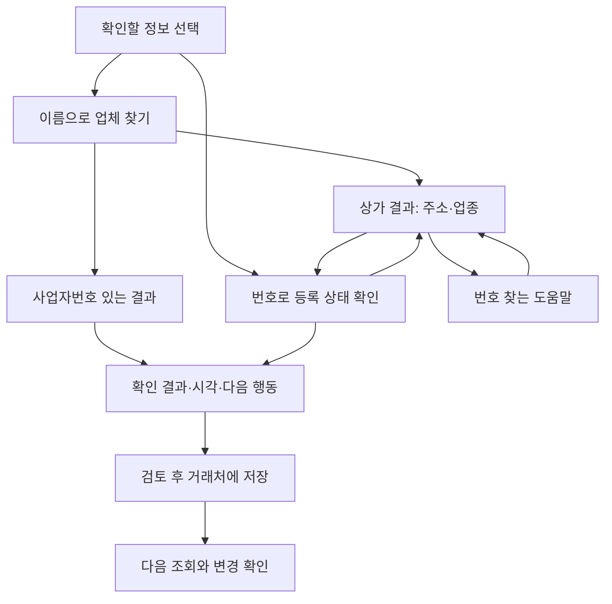

# 사업자정보 인사이트: 기획설계와 구현계획

기획 기준일: 2026-10-28, 한국시간 · 구현·검수 기록: 2026-10-28~29

대상: 사업자한눈의 검색·조회 결과·거래처 저장 흐름  
기준 소스: `main` / `44440c7ce50f45eff38535518733e17ed0f08d43` / v0.6.0  
작업 브랜치: `feat/insights-ux-20261028`  
목표 버전: v0.7  
문서 상태: 기획·구현·Preview 핵심 흐름 검수 기록. 운영 배포 판정은 [PR #4 최종 검증 기록](https://github.com/softm/bizhannun/pull/4)을 따르며 실제 사용자 관찰은 별도 미실행 항목.

## 1. 이번 작업의 목적과 완료의 의미

사용자 요청은 “현재 구현이 사용하기 어렵고 이해하기 쉽지 않다. 세밀한 기획설계를 통해 구현계획을 수립하고 빈틈없이 진행하라”이다. 이번 작업은 조회 기능이 존재하는지에 더해, 사용자가 **어디서 시작할지, 결과가 무엇을 뜻하는지, 다음에 무엇을 할지**를 이해할 수 있게 만드는 데 집중한다.

완료 여부는 코드 작성, 자동검사, 화면 검수, 실계정 연동, 운영 배포, 실제 사용자 이해도를 각각 구분한다. 자동검사를 통과했다고 외부 API 활용승인이나 계정 복원, 사용성 검증까지 끝났다고 기록하지 않는다. 실행 결과는 [VERIFICATION.md](VERIFICATION.md)에 명령·환경·결과·미실행 항목과 함께 남긴다.

| 완료 수준 | 필요한 증거 | 증거 없이 쓰지 않을 표현 |
| --- | --- | --- |
| 구현 | 해당 파일과 동작 코드, 변경 내용 | 아이디어만 있는 기능을 “구현 완료”로 표현 |
| 자동검증 | 실제 실행한 검사와 통과·실패·건너뜀 수 | 테스트 파일이 있다는 이유로 “전체 통과”로 표현 |
| 화면 검수 | 대상 버전의 실제 화면에서 동작·폭·포커스 확인 | 코드만 읽고 “모바일 검수 완료”로 표현 |
| 외부 연동 | 해당 계정·원천으로 성공 응답이나 복원 확인 | 키 존재·CI 성공을 “실연동 완료”로 표현 |
| 운영 반영 | 최종 커밋·배포 실행·운영 화면 대조 | 브랜치 작성이나 PR 생성만으로 “배포 완료”로 표현 |
| 이해도 개선 | 관찰 과제의 실제 결과 | 목표 시간·성공률을 이미 측정한 성과로 표현 |

## 2. 어디까지 구현돼 있는가

다음은 기준 소스와 저장된 자료를 읽어 확인한 상태다. 기존 문서의 과거 운영 검사 결과는 그 날짜의 기록이며 이번 버전의 재검증을 대신하지 않는다.

| 영역 | 기준 소스에서 확인한 내용 | 완료 수준·남은 한계 | 근거 |
| --- | --- | --- | --- |
| 전국 상가 이름 검색 | 소상공인시장진흥공단 명부 2,772,484곳, 원천 기준일 2026-06-30, 1,159개 검색 파일, 지역 필터·부분 이름 검색 | 코드·수집본 존재. 모든 사업자등록 업체를 망라하지 않으며 번호·현재 영업 여부를 제공하지 않음 | [명세](../data/store-catalog/manifest.json), [검색 모델](../src/store-catalog.mjs), [이전 운영검증](DEPLOYMENT_V06.md) |
| 번호가 연결된 이름 검색 | 공개 상세자료 네이버·서해박속낙지전문점 2곳과 현재 공간의 거래처·프로필 | 전국 상가 수와 별도 집계. 개인 저장정보는 사용자마다 다름 | [공개 목록](../data/enrichment/index.json), [사업자 검색](../src/business-search.mjs) |
| 국세청 등록 상태 | 10자리 번호로 계속·휴업·폐업, 과세유형, 확인 시각 처리 | 브라우저 직접 호출 경로 존재. 실제 조회는 운영 인증키·원천 응답에 의존하며 이번 작업에서 별도 확인 필요 | [직접 API](../src/direct-api.mjs), [운영 설정](PAGES_DIRECT.md) |
| 공개 상세정보 | 사업자번호·확인된 도메인 기준의 상호·주소 등 연결, 출처·수집 시각·미확인 후보 분리 | 공개 연결 범위가 2곳이고 수집 상태는 `partial`. 어댑터 구현과 자료 확보는 다름 | [정보 연결](../src/business-profile.mjs), [인사이트](../src/business-insights.mjs), [수집본](../data/enrichment/index.json) |
| 추가 원천 API | 근로복지공단·금융위·공정위·DART·네이버·카카오 어댑터 및 상태 표시 | 기준 수집본에서 근로복지공단·금융위는 활용승인 오류, 공정위·DART·네이버·카카오는 설정 대기. 최신 승인 상태는 별도 확인 필요 | [수집본의 sourceStatuses](../data/enrichment/index.json), [공개자료 안내](BUSINESS_ENRICHMENT.md) |
| 조회 상세·인사이트 | 단일 상세, 기본정보·출처·조회이력, 재확인·값 차이·자료 누락에 대한 행동 | 기능은 존재하나 데이터 건수·내부 용어가 결과 이해를 앞서는 구조 | [조회 화면](../src/business-workbench-view.mjs), [인사이트 계산](../src/business-insights.mjs) |
| 거래처 관리 | 등록·수정·메모·태그·CSV·일괄확인·변경기록·백업 | 번호 없는 상가를 거래처로 저장하는 모델은 없음. 자동 상시 감시도 없음 | [앱](../src/app.mjs), [기기 저장](../src/storage.mjs), [거래처 상세](BUSINESS_DETAIL.md) |
| 기존 계정 저장 | Firebase 인증과 UID별 Firestore 저장 경로, 비로그인 IndexedDB 분리 | 이번 화면 변경 뒤 실계정 저장·다른 기기 복원은 별도 검증 대상 | [계정 저장](../src/cloud-storage.mjs), [인증](../src/auth.mjs) |
| 공통 계정·보관소 | 공통 SDK 로딩과 `SoftmSiteState` bridge, 현재 작업공간의 명시적 저장·복원 연결 | 기존 앱 계정과 자동 병합하지 않음. 네이버 공개 검수와 실계정 복원 범위는 별도 | [공통 보관소](COMMON-VAULT.md), [진입 HTML](../index.html), [앱 bridge](../src/app.mjs) |

공개 명부의 **원천 기준일**, 앱의 **실제 수집일**, 국세청의 **조회 시각**은 서로 다르다. 수집 실행이 오늘 끝났다고 명부 내용이나 이전 상태가 오늘 확인된 사실로 바뀌지 않는다.

## 3. 사용자 과제와 우선순위

| 사용자 상황 | 해결할 과제 | 성공한 결과 |
| --- | --- | --- |
| 업체 이름만 아는 신규 사용자 | 동명 업체·지점을 주소와 업종으로 구별 | 찾는 상가를 선택하고, 아직 확인하지 못한 등록 상태를 구분함 |
| 사업자번호를 받은 거래 담당자 | 조회 당시 등록 상태와 과세유형 확인 | 결과·시각·출처를 이해하고 필요한 후속 행동이나 저장으로 이동함 |
| 기존 거래처를 관리하는 사용자 | 지난 기록과 지금 상태 비교, 메모 보존 | 같은 번호의 이전 정상 결과와 비교하고 변화·실패를 구분함 |
| 자기 사업을 관리하는 사용자 | 확인한 정보를 내 사업 프로필로 활용 | 공개정보를 검토한 뒤 기존 프로필 저장 흐름을 사용함 |

첫 세 과제가 이번 개선의 주 흐름이다. 내 사업과 지원사업 탐색은 기존 기능으로 연결하되 검색 결과 화면에서 모든 기능을 동시에 설명하지 않는다.

### 이번 범위

검색 목적 선택, 두 결과 종류의 구분, 번호 찾는 도움말, 상가·번호 조회 사이의 복귀, 쉬운 결과 설명, 이전 성공 결과의 분리, 자료 부족 표현, 저장 완료와 위치 안내, 관련 문서 정합성을 다룬다.

### 별도 설계가 필요한 후속 범위

번호 없는 관심 상가 저장, 상가와 사업자의 수동 연결 검토 절차, 새로운 공식 API 승인·계약, 주기적 자동 상태 감시·알림, 계정 체계 통합, OCR·신용평가·비공개 매출 추정은 이번 화면 개선에 포함하지 않는다. 필요한 후속 작업은 13절에서 관리한다.

## 4. 사용자 흐름

번호 입력에서 상가로 돌아가는 화살표는 **원래 검색으로 복귀하는 경로**다. 상가와 번호 조회 결과를 합치는 관계가 아니다. 같은 이름이거나 주소가 비슷하다는 이유로 연결을 확정하지 않는다.

## 5. 화면별 정보 우선순위

| 화면 | 먼저 보일 내용 | 주요 행동 | 접거나 뒤로 둘 내용 |
| --- | --- | --- | --- |
| S0 시작 | `어떤 정보를 확인할까요?`, 두 목적, 목적별 입력 라벨·예시 | `업체 찾기` 또는 `등록 상태 확인` | 전체 데이터 수·검색 문법·수집 일정은 `어디까지 확인할 수 있나요?` |
| S1 이름 결과 | 검색어·확인한 결과 수, 서로 다른 두 결과 제목, 업체명·지점·주소 | `주소·업종 보기` 또는 `등록 상태 확인` | 출처 건수·전체 색인 규모·갱신 진단 |
| S2 상가 상세 | 상호·지점, 명부 정보라는 설명, 주소·업종 | `사업자번호 입력`, `번호 찾는 방법`, 결과 복귀 | 상가업소번호·분류체계·수집시각은 `자료 출처와 기준일` |
| S3 번호 입력 | 10자리 입력, 입력값 오류, 번호 도움말 | `등록 상태 확인` | 상가에서 왔다면 이전 상가를 복귀용 맥락으로 표시하고 자동 연결하지 않음을 설명 |
| S4 확인 결과 | 확인한 사실 → 의미 → 시각 → 다음 행동 | 상황에 맞는 1개 우선 행동, `거래처에 저장` | 미확보 여섯 항목·출처 수·후보 수·수집 진단 |
| S5 업체 정보 | 확보된 값과 원천, 없는 항목의 중립 표시 | 자료 확인·출처별 값 비교 | 원천 기술 상태는 자료 출처 탭 |
| S6 자료 출처 | 연결 자료·확인 전 후보·원천 시각 | 원문 보기, 필요 시 추가 요청 | API 설정·수집 진단·JSON은 펼쳐 보기 |
| S7 확인 기록 | 해당 번호의 실제 조회 순서, 정상 간 변화와 실패 구분 | 이전 기록 확인 | 전체 거래처 지표를 반복하지 않음 |
| S8 저장 완료 | 저장 성공 여부·저장 위치·기록 유지 안내 | `저장한 거래처 보기` | 저장소 내부 명칭은 일반 사용 흐름에서 설명하지 않음 |

번호 조회 상세의 탭은 `확인 결과 / 업체 정보 / 자료 출처 / 확인 기록`으로 한다. 기술상 탭 키 `overview / facts / sources / history`는 유지할 수 있다. 저장 거래처 상세의 기존 5탭 전체 재구성은 별도 회귀 범위가 필요하므로 이번 완료 여부와 혼동하지 않는다.

### 인사이트의 표현 원칙

한 안내는 확인한 사실, 그 의미, 할 일로 구성한다. 예를 들어 “마지막 정상 조회 후 7일을 넘겼습니다 → 지금 상태는 다시 확인이 필요합니다 → 상태 다시 확인”이다. 한 화면에서 동시에 강조하는 행동은 최대 2개로 제한한다. 정보 확보 항목 수는 조회 성공·실패나 업체 신뢰도를 나타내는 점수로 사용하지 않는다.

국세청 조회 성공과 공개자료 없음이 함께 있으면 “국세청 등록 상태는 확인했습니다. 상호·주소는 아직 연결된 공개자료가 없습니다”라는 관계를 전달한다. 사용자가 이미 마친 작업을 실패로 오해하게 하지 않는다.

## 6. 상태 전환과 복귀 규칙

| 현재 상태·사건 | 표시·동작 | 반드시 보존하거나 초기화할 내용 |
| --- | --- | --- |
| 처음 방문 | 이름 찾기와 번호 상태 확인을 선택 가능 | 조회 기록·저장정보를 임의 변경하지 않음 |
| 목적 변경 | 목적별 설명·키보드·버튼·입력 길이 변경 | 입력 초안은 목적별 보존. 진행 중 이전 요청은 취소·무효화 |
| 한국어 조합 입력 중 | 사용자가 쓰는 글자와 커서를 유지 | 목록 갱신을 위해 조합 중 입력 요소를 교체하지 않음 |
| 이름 검색 중 | 준비 중/검색 진행/현재 확인 결과 표시 | 완료 전에 0건으로 단정하지 않음 |
| 검색 중 지역 변경 | 선택 지역으로 다시 검색 | 이전 지역의 늦은 결과가 새 결과를 덮어쓰지 않음 |
| 같은 검색 재제출 | 중복 요청 억제 | 기존 진행 상태 유지 |
| 상가 선택 | 단일 상가 상세, 결과 목록은 접음 | 검색어·지역·페이지·선택 상가 ID 보존 |
| 번호가 있는 업체 선택 | 해당 번호로 국세청 조회 | 이름 유사 후보를 임의 선택하지 않으며 1개 결과도 명시적 선택 |
| 상가에서 번호 입력으로 이동 | 이전 상가 설명과 복귀 버튼 | 검색 맥락의 사본을 보존. 상가 ID는 조회 번호로 사용하지 않음 |
| 번호 찾는 방법 열기 | 도움말 모달 | 검색·선택·입력 상태 그대로 유지. 닫으면 원래 흐름으로 복귀 |
| 원래 검색으로 돌아가기 | 선택 상가 또는 결과 목록 복원 | 입력어·지역·페이지 유지. 복원된 상가에는 사업자번호를 주입하지 않음 |
| 새 이름 검색 제출 | 새 결과로 전환 | 이전 상가·번호 조회 결과와 섞이지 않게 선택 상태 초기화 |
| 동일 번호 재조회 | 같은 상세와 탭에서 진행 표시 | 이전 성공 기록은 원래 시각으로 유지 |
| 다른 번호 조회 | 새 번호 상세로 전환 | 이전 번호의 상호·상태·과세·출처가 새 제목 아래 남지 않음 |
| 계정 전환·로그아웃 | 전환된 공간의 저장정보로 재구성 | 개인 검색 색인·원래 검색 맥락·선택 결과·늦은 응답 초기화 |
| 저장 성공 | 위치를 포함한 완료 메시지와 저장 결과 진입 | 서버/기기 저장이 확정된 뒤에만 성공 표시 |
| 저장 실패·충돌 | 실패 이유와 재시도/최신 기록 확인 | 사용자의 편집 초안과 기존 정상 자료 보존 |

원래 검색 맥락은 현재 탭의 화면 상태다. 개인 거래처나 공통 보관소에 검색 내역을 새로 자동 저장하는 기능으로 확장하지 않는다.

## 7. 결과·오류·빈 화면 문구 계약

| 조건 | 사용자가 이해해야 할 내용 | 제공할 행동 | 금지할 해석 |
| --- | --- | --- | --- |
| 최신 정상 결과: 계속사업자 | 조회 시점의 세무 등록 상태가 계속사업자 | 받은 등록증과 정보 대조, 거래처 저장 | 실제 영업·지급능력·안전한 거래 보장 |
| 최신 정상 결과: 휴업자 | 조회 시점에 휴업자로 등록 | 거래 일정 확인, 등록증 정보 대조 | 곧바로 불량·사기로 분류 |
| 최신 정상 결과: 폐업자 | 해당 번호가 조회 시점에 폐업자로 등록 | 현재 사용하는 사업자번호 확인·수정 후 재조회 | 동명 상가까지 폐업으로 확장 |
| 성공 기록이 7일을 넘김 | 이전 상태와 현재 확인 필요를 구분 | 지금 다시 조회 | 예전 상태를 지금 확인된 결과처럼 표시 |
| 조회 시각 누락·미래 | 시점을 신뢰할 수 없어 재확인 필요 | 다시 조회 | 현재 상태 확정 |
| 결과 없음 | 입력 번호로 등록정보를 찾지 못함 | 번호 확인·수정 | 폐업 또는 미등록 단정 |
| 조회 실패, 이전 성공 있음 | 이번 실패와 이전 성공 상태를 따로 표시 | 재시도 | 실패를 폐업으로 변경하거나 이전 결과의 시각 갱신 |
| 조회 실패, 이전 성공 없음 | 현재 상태 미확인 | 재시도 | 성공 배지·정상 상태 추정 |
| 조회 설정 대기 | 서비스 연결 문제 | 재시도 또는 보조 연결 안내 | 일반 사용자에게 인증키 입력을 주된 해결책으로 요구 |
| 공개자료 없음 | 해당 항목의 자료를 아직 확보하지 못함 | 받은 서류와 비교, 업체 정보 보기 | 업체에 문제가 있다는 경고 |
| 이름 검색 정상 완료 0건 | 검색한 명부/저장범위에 결과 없음 | 다른 이름·지역, 번호 입력, 번호 찾는 방법 | 전국 모든 업체에 존재하지 않음 |
| 일부 검색 실패 | 확인된 결과만 표시, 총건수 미확정 | 다시 검색 | 0건 확정·전체 검색 완료 |
| 수집 실패·이전 자료 있음 | 과거 자료의 실제 수집일을 유지 | 출처·수집 상태 확인 | 새로 확인한 자료처럼 날짜 변경 |
| 출처별 값 차이 | 동일 번호 자료의 기준·시점·표현이 다를 수 있음 | 각 값과 날짜 비교 | 어느 값이 오류인지 자동 단정 |

7일 상태 재확인과 30일 공개자료 재확인은 앱의 안내 기준이다. 제공기관의 공식 갱신 주기나 법정 유효기간으로 설명하지 않는다.

## 8. 버튼별 동작 계약

| 버튼·내부 동작 | 전제 | 실행 결과와 부수효과 | 복귀·실패 처리 |
| --- | --- | --- | --- |
| 이름으로 업체 찾기 / `lookup-intent` | 없음 | 이름 입력으로 전환. 검색만으로 저장하지 않음 | 목적별 초안 보존, 이전 요청 무효화 |
| 번호로 등록 상태 확인 / `lookup-intent` | 없음 | 번호 입력으로 전환 | 이름 검색 맥락이 있으면 복귀 경로 보존 |
| 주소·업종 보기 / `select-store-result` | 현재 검색 결과의 상가 ID | 해당 상가 상세만 표시. 국세청 호출·거래처 저장 없음 | 선택 제목으로 초점 이동 |
| 등록 상태 확인 / `select-name-result` | 현재 결과의 유효한 사업자번호 | 번호로 국세청 조회 | 불일치 응답은 실패로 처리 |
| 사업자번호 입력 / `search-by-number` | 상가 상세 또는 빈 결과 | 빈 번호 입력과 이전 검색 맥락 표시 | 입력한 번호를 이전 상가의 속성으로 저장하지 않음 |
| 번호 찾는 방법 / `number-help` | 없음 | 등록증·세금계산서·영수증·거래처 문의 안내 | 외부 요청이나 자동 저장 없이 모달 닫기 |
| 상가/검색 결과로 돌아가기 / `return-lookup-origin` | 복귀 맥락 존재 | 검색어·지역·페이지·선택 결과 복원 | 복원 시 번호 조회 결과와 혼합하지 않음 |
| 사업자번호 확인·수정 / `edit-lookup-number` | 현재 조회 번호 | 번호 입력을 수정할 수 있게 초점 이동 | 기존 번호는 식별 가능한 초안으로 유지 |
| 상태 다시 확인 / `insight-refresh-status` | 유효한 번호 | 동일 번호 재조회, 등록 거래처라면 기존 정책에 따라 기록 갱신 | 중복 방지, 이전 성공/현재 실패 분리 |
| 서로 다른 정보 비교 / `insight-view-sources` | 비교 가능한 차이 존재 | 해당 탭·근거 영역을 열고 초점 연결 | 저장정보 변경 없음 |
| 거래처에 저장 / `save-lookup` | 번호 조회 결과 존재 | 등록/수정 모달에서 이름·태그·메모 검토 후 저장 | 모달을 여는 것만으로 저장하지 않음 |
| 등록증 정보 대조 / `validate-registration` | 사업자번호·개업일·대표자명 | 입력값을 국세청 등록정보와 대조 | 대표자명·개업일은 거래처 기록에 자동 보관하지 않음 |
| 자료 추가 요청 / `enrichment-request` | 유효한 번호 | 외부 GitHub 공개 요청 작성 경로 설명 후 사용자가 이동 | 즉시 수집·비공개 문의로 표현하지 않음. 내부 메모 자동 포함 금지 |

기능명 대신 제공할 정보를 설명하는 버튼 문구를 사용한다. 모든 동작에 “더 보기”를 반복하지 않고, `주소·업종 보기`, `등록 상태 확인`, `정보 비교`, `저장한 거래처 보기`처럼 도착점을 알린다.

## 9. 정보 연결과 저장 위치

| 정보 | 연결 기준 | 저장·전송 위치 | 이번 개선의 원칙 |
| --- | --- | --- | --- |
| 공개 상가 | 원천 상가업소번호, `semas:` ID | 공개 수집 파일, 현재 탭의 검색 상태 | 번호 없는 명부자료로 유지. 사업자번호로 변환하지 않음 |
| 국세청 결과 | 입력한 10자리 사업자번호와 응답 번호 일치 | 조회 시 국세청 전달. 저장한 거래처의 확인 기록은 현재 작업공간 | 등록 상태와 상호 출처를 구분 |
| 공개 상세정보 | 동일 번호 또는 기존 확인된 공식 도메인 규칙 | 공개 수집본, 출처를 포함한 개인 저장 사본 | 이름·주소 유사성만으로 결합하지 않음 |
| 별칭·메모·태그 | 현재 작업공간의 거래처 | 비로그인 IndexedDB, 기존 앱 로그인 시 UID별 Firestore | 공개 상호로 덮어쓰지 않음. 검색·원천 수집에 보내지 않음 |
| 입력 중 초안 | 현재 화면·거래처 | 현재 탭의 편집 상태 | 탭/도움말/실패로 잃지 않음 |
| 원래 이름 검색 | 현재 탭의 검색어·지역·페이지·선택 사본 | 현재 탭 메모리 | 계정 전환 시 초기화. 백업 자료에 임의 추가하지 않음 |
| 공통 보관소 저장본 | 공통 사용자·사이트별 범위 | 기기 암호화 후 사이트별 보관소 | 기존 앱 계정과 자동 병합하지 않으며 명시적 저장·복원 사용 |

공통 보관소는 현재 작업공간을 백업하는 별도 경로다. 기준 bridge는 기존 사업자 계정에 로그인한 상태에서 복원을 차단하고 기기 모드에서 복원하도록 안내한다. 최초 연결·계정 전환·메모 편집 중 자료를 자동 덮어쓰지 않는 정책을 유지한다. 세부 운영 절차는 [COMMON-VAULT.md](COMMON-VAULT.md)를 따른다.

저장 완료 문구는 `이 브라우저에 저장했습니다` 또는 `로그인한 계정에 저장했습니다`처럼 실제 목적지를 구분한다. 공통 보관소에도 자동 저장됐다고 함께 단정하지 않는다.

## 10. 모바일·키보드·읽기 기준

- 360px·390px와 일반 데스크톱 폭에서 주요 입력·버튼·주소를 가로 스크롤 없이 이용할 수 있어야 한다.
- 긴 상호·주소·출처 URL은 줄바꿈하고, 중요한 행동이 줄임표로 사라지지 않게 한다.
- 버튼과 목적 선택은 높이 44px 이상의 터치 영역을 목표로 한다. 실제 화면에서 확인한 결과를 기록한다.
- 입력 라벨은 보이게 제공한다. placeholder만으로 필요한 정보나 입력 목적을 설명하지 않는다.
- 키보드로 목적 선택·검색·결과 선택·탭·도움말 닫기·원래 결과 복귀가 가능해야 한다.
- 선택 후 제목, 탭 이동 후 탭/패널, 모달 닫기 후 시작 버튼 등 다음 작업에 필요한 곳으로 초점을 보낸다.
- 색 외에 `현재 상태 미확인`, `이전 기록`, `명부 정보` 같은 문구를 함께 쓴다.
- 진행률과 결과 변화는 간결히 알린다. 모든 결과 영역을 갱신 때마다 과도하게 읽어주지 않는다.
- 200% 글자 확대에서 정보가 겹치거나 주요 버튼이 가려지는지 확인한다. 수행하지 않은 검수는 통과로 기록하지 않는다.

## 11. 구현 순서와 단계별 완료 조건

아래는 의존 순서와 완료 조건이다. 구현 코드 `8104329859dad0db94bb6933783c0caf7c70eafe`에서 전체 JavaScript 391개 중 390개 통과·실패 0개·건너뜀 1개, check·build 재통과를 확인했다. 최신 Preview의 READY 상태를 확인한 뒤 검색·상가 선택·번호 입력·원래 결과 복귀·기기 저장의 핵심 흐름을 실제로 검수했다. 실계정·IME·글자 확대·사람 관찰은 별도 미실행 항목이다. 상세 증거는 [검증 기록](VERIFICATION.md), 병합 후 Pages·운영 최종 대조는 [PR #4](https://github.com/softm/bizhannun/pull/4)를 따른다.

| 단계 | 우선순위 | 작업 | 주 대상 | 완료 조건 | 작성 시 상태 |
| --- | --- | --- | --- | --- | --- |
| 0. 기준 확인 | P0 | 최신 소스·검색 범위·API·계정 경로 대조 | main·공개 명세·기존 문서 | 현재 기능/한계가 근거와 함께 분리됨 | 소스·자료 확인 |
| 1. 시작과 복귀 | P0 | 목적 선택·설명·초안·도움말·원래 검색 복원 | `app.mjs`, `lookup-journey.mjs` | 두 목적 전환과 상가→번호→복귀에서 맥락·식별자 규칙 유지 | 구현·자동검증 및 Preview 핵심 왕복 검수 완료. 지점·지역·페이지·번호/미제출 이름 초안 보존, 다른 상가 선택 시 이전 번호 초기화 확인 |
| 2. 검색과 상가 상세 | P0 | 결과 종류 구분·쉬운 CTA·기술자료 접기 | `business-search-view.mjs`, `store-catalog-view.mjs` | 번호 없는 상가의 주소·업종과 번호 필요성이 명확함 | 구현·렌더 검증·Preview 실제 검색 완료. 스타벅스 충남 54곳, 네이버 번호 결과 1곳과 명부 결과 분리 확인 |
| 3. 확인 결과 | P0 | 사실·의미·시각·다음 행동, 실패/과거 결과 분리 | `business-outcome.mjs`, `business-workbench-view.mjs` | 모든 결과 상태의 문구·행동이 근거와 일치함 | 구현·모델/렌더 검증 완료. Preview 연결 대기·공개 네이버 분리·늦은 상가 응답 차단 확인. 운영 실조회 최종 대조는 PR #4 추적 |
| 4. 저장과 도움말 | P1 | 저장 위치·실패·성공·저장 결과 진입, 외부 요청 안내 | `app.mjs`·관련 문구 | 실제 저장 성공 뒤 완료 표시, 외부 요청 성격 명시 | 기기 저장·바로 상세·재조회 배너 제거·새로고침 후 별칭/태그/메모 보존 확인. 공개 요청 모달의 내부정보 제외 확인. 실계정 별도 |
| 5. 통합 검수 | P0 | 전체 회귀·빌드·실제 화면·모바일·키보드 | 테스트·실행 화면 | 12절의 필수 시나리오 통과 또는 미실행 사유 명시 | 자동검사·check·build와 Preview 핵심 흐름 검수 완료. 360/390px 주요 화면 폭·초점 확인. IME·글자 확대·실계정 미실행 명시 |
| 6. 변경 검토와 운영 | P0 | 최종 diff·문서·커밋·배포·운영 대조 | 브랜치·CI·운영 URL | 최종 소스와 배포 버전 일치, 핵심 흐름 확인 | 구현 코드 `8104329`의 CI 40710604241 성공, READY Preview 검수·실제 화면 기록 확보. 병합 후 Pages 실행·운영 화면·NTS 최종 대조 판정은 PR #4 최종 기록 참조 |
| 7. 후속 사용성 확인 | P1 | 처음 쓰는 사람의 관찰 과제 | 실제 사용자 관찰 | 오해·막힌 단계와 후속 수정 목록 기록 | 미실행 |

한 단계의 실패를 다른 기능 추가로 덮지 않는다. 번호 오연결, 개인정보 공간 혼합, 실패를 정상으로 표시, 입력/저장자료 손실은 다음 단계로 넘어가기 전에 해결할 필수 중단 사유다. 스타일 수치·보조 설명의 개선은 핵심 흐름 검수가 끝난 뒤 우선순위를 판단한다.

## 12. 요구사항과 수용 기준

| ID | 검수 시나리오 | 통과 기준 | 확인 방법 |
| --- | --- | --- | --- |
| U01 | 처음 방문 | 이름 찾기와 등록 상태 확인의 차이, 필요한 입력을 화면에서 알 수 있음 | 실제 화면·관찰 |
| U02 | 이름 검색에 두 종류 결과 | 각 결과의 제공 정보와 선택 후 동작이 다르게 명시됨 | 렌더 검증·실제 화면 |
| U03 | 같은 이름·다른 지점/번호 | 별도 후보로 남고 주소·번호로 구별 가능 | 검색 모델·렌더 검증 |
| U04 | 번호 없는 상가 선택 | 국세청 호출·거래처 저장이 발생하지 않음 | 이벤트 흐름·테스트 |
| U05 | 상가 원본에 예상 밖 번호가 섞임 | 검색 복귀 사본과 상가 화면이 이를 조회 번호로 채택하지 않음 | 상가 뷰·journey 테스트 |
| U06 | 상가→번호 입력→원래 결과 복귀 | 검색어·지역·페이지·선택 유지, 번호 결과와 자동 연결 없음 | journey 테스트·실제 화면 |
| U07 | 번호를 모름 | 도움말 후 이전 위치로 복귀, 검색 맥락 유지 | 실제 화면·키보드 |
| U08 | 국세청 성공·공개자료 없음 | 등록 상태 확인 성공이 우선, 자료 부족은 별도 중립 설명 | outcome·workbench 테스트 |
| U09 | 실패·이전 성공 존재 | 이번 실패와 원래 날짜의 이전 결과를 구분 | outcome·workbench 테스트 |
| U10 | 실패·이전 성공 없음 | 상태를 추정하지 않으며 재시도 경로 존재 | outcome 테스트 |
| U11 | 오래됨·시각 누락·미래·미해석 응답 | 현재 확인으로 승격하지 않으며 재확인 안내 | outcome 경계값 테스트 |
| U12 | 등록정보 없음 | 번호 수정 동작, 폐업 단정 없음 | outcome·이벤트 검증 |
| U13 | 정상 0건·검색 중·부분 실패 | 서로 다른 설명과 복구 행동, 미완료 총건수 미확정 | 검색 뷰 테스트 |
| U14 | 조회 중 업체·목적·계정 변경 | 늦은 응답이 현재 화면·개인 공간을 덮어쓰지 않음 | 기존 회귀·실제 전환 |
| U15 | 저장 성공·실패·충돌 | 실제 성공 때만 위치 포함 완료, 기존 메모·태그 보존 | 저장 회귀·기기/계정 검수 |
| U16 | 자료 추가 요청 | GitHub 공개 요청임을 사전 설명, 내부 메모 자동 포함 없음 | 문구·실제 동작 대조 |
| U17 | 360px·390px·데스크톱·글자 확대 | 주요 입력·버튼·주소가 잘리지 않음 | 화면·문서 폭 검수 |
| U18 | 키보드·한국어 조합 입력 | 검색·탭·모달·복귀 가능, 조합·포커스 보존 | 실제 키보드 검수 |
| U19 | 외부 문자열·URL | HTML·속성 주입 차단, 안전한 링크만 사용 | 기존 escape·URL 검증 |
| U20 | 문서 대조 | 277만 상가와 2곳 상세 범위, 기존 계정과 공통 보관소, 계획과 결과 구분 | 문서 검토 |

기존 도메인·조회·수집·검색·보관 테스트도 함께 실행한다. 새 테스트는 실패를 실제 상태로 오인하거나 상가 ID를 번호로 연결하는 회귀, 원래 검색 맥락 손실처럼 사용자 결과에 영향을 주는 조건에 집중한다.

### 사용자 관찰 목표

처음 쓰는 사용자에게 “이름만 아는 업체의 주소 찾기”, “제공된 번호의 상태와 시각 설명하기”, “번호를 모를 때 다음 행동 찾기”, “조회 결과 저장 후 다시 열기”를 요청한다. 진행자가 기능 위치를 먼저 알려주지 않고 막힌 위치·잘못 이해한 문구·복귀 실패를 기록한다.

목표는 두 검색 결과를 구별하고, 계속사업자를 거래 안전 보장으로 해석하지 않으며, 도움 없이 다음 행동을 고르는 것이다. 관찰 인원·시간·과제 성공률은 실제 관찰 뒤 기록한다. 이 문서는 아직 측정한 사용시간이나 개선률을 제시하지 않는다.

## 13. 후속 과제와 착수 조건

| 과제 | 필요한 선행 확인 | 완료를 판단할 증거 |
| --- | --- | --- |
| 실계정 저장·동기화·복원 | 테스트에 사용할 계정·기기·자료 범위 | 저장 후 다시 로그인/다른 기기에서 같은 내용 확인, 원래 계정 분리 유지 |
| 공통 네이버 공개 이용 | 개발회원 외 사용 가능 여부·공개 검수 | 일반 계정 인증 성공과 사용자 안내 정합성 |
| 추가 공식 데이터 원천 | 원천별 활용승인·키·응답 구조·조회 범위 | 실제 성공 응답, 번호 일치, 자료 시점, 누락·실패 처리 검증 |
| 번호 없는 관심 상가 저장 | 확인된 거래처와 별도 식별자·목록·저장 모델 | 상가 ID와 사업자번호 혼합 없이 저장·복귀·추후 연결 검토 가능 |
| 상가와 번호의 수동 연결 | 사용자가 제시할 근거·확인 절차·철회 방법 | 수동 주장과 공식 번호 일치 근거를 구분하고 잘못된 연결 복구 가능 |
| 저장 거래처 상세의 정보구조 통일 | 현재 5탭·메모 초안·인쇄/내보내기 회귀 범위 | 조회 상세와 용어 정합성, 메모·이력 기능 유지 |
| 관찰 기반 사용성 개선 | 처음 사용하는 사람의 과제 수행 | 막힌 단계·실제 오해·변경 전후 결과 기록 |

공공 API 연결 대기 때문에 이름 검색·기본 번호 조회·기기 거래처 기록의 개선을 멈출 필요는 없다. 다만 연결되지 않은 원천을 사용할 수 있는 기능처럼 설명하지 않는다.

## 14. 현재 검증·배포 기록

다음은 확인된 실행 결과만 기록한 상태표다. 초기 `66d8c37` Preview와 데이터 요청 수정 후 `8104329` Preview의 결과를 구분한다. 운영 판정은 [PR #4 최종 검증 기록](https://github.com/softm/bizhannun/pull/4)의 병합 커밋·Pages 실행·운영 대조 증거를 따른다.

| 확인 항목 | 결과·근거 |
| --- | --- |
| 최신 코드 커밋 | [`8104329859dad0db94bb6933783c0caf7c70eafe`](https://github.com/softm/bizhannun/commit/8104329859dad0db94bb6933783c0caf7c70eafe) |
| 전체 JavaScript | 391개 중 390 통과·실패 0개·Firestore 에뮬레이터 1개 건너뜀 |
| 집중 회귀·Python | 공개자료 요청 수정 관련 49개 통과. Python 수집 회귀는 기존 실행 5개 통과이며 최신 수정 후 재실행으로 기록하지 않음 |
| 정적검사·빌드 | JavaScript 86개·JSON 8개 check 통과, 공개 파일 1,202개 build 재통과 |
| 실제 확인한 직전 Preview | `66d8c37`: 첫 화면 1920px/360px, 짧은 번호 `12345` 검증 시 입력·초점 보존, 도움말 Escape 뒤 원버튼 초점·입력값 보존, End로 `확인 기록` 이동·보이는 패널 1개 |
| Preview의 번호 조회 표시 | NTS 키 미설정의 연결 대기와 업체 상태를 분리. 최신 Preview에서 당진 상가 맥락의 네이버 번호 조회는 공개 네이버 결과·저장 폼으로 표시하고 상가와 자동 결합하지 않음. 국세청 성공 응답 검증은 아님 |
| 발견·수정한 자료 요청 장애 | 보호된 Preview의 `omit`으로 자료 검색 실패를 확인해 공개 상세목록·상가 명세·검색 파일을 `same-origin`으로 수정. 외부 NTS `omit` 유지. 최신 Preview의 실제 이름 검색으로 복구 확인 |
| 최신 Preview | [검증용 URL](https://bizhannun-1s7jmuqf0-softms-projects.vercel.app), `dpl_D9xMGkTrkpcZTyYmmF6p1LWYncGJ`. **READY**, 핵심 흐름 실제 검수 완료 |
| 이름 검색·상가·번호 왕복 | 스타벅스 충남(44) 54곳, 2/6페이지에서 천안서북이마트 선택 → 번호 입력 → 복귀 시 지점·지역·페이지·초안 보존. 미제출 이름 초안도 보존. 다른 당진 상가 선택 후 번호 입력은 이전 번호를 비움 |
| 번호 결과·늦은 응답 | 네이버 이름 검색의 번호 결과 1곳과 명부 결과 분리. 검색 중 번호 후보 선택 후 늦은 상가 응답이 상세를 덮지 않음 |
| 기기 저장·기록 보존 | Preview에만 합성 시험 거래처를 생성해 브라우저 저장 위치·상세 바로 열기·재조회 후 과거 저장 배너 0개·새로고침 후 별칭/태그/메모 유지 확인 |
| 공개자료 요청 | GitHub 공개·사용자 직접 제출 설명, 번호·공개 네이버 이름·빈 웹사이트만 채움 확인. 내부 별칭·태그·메모 자동 포함 없음. 게시 미실행 |
| 모바일·키보드·글자 확대 | 최신 Preview 360px의 첫 화면·상가 상세·번호 결과, 390px의 첫 화면·번호 결과에서 각각 clientWidth=scrollWidth 확인. 데스크톱도 clientWidth=scrollWidth=1920. 주요 초점 이동 확인. 390px 상가 상세·IME·200% 글자 확대는 별도 미실행 |
| 실제 화면 근거 | `8104329` Preview [데스크톱 1920×780 본문](screenshots/insights-v07-desktop.png) · [모바일 390×844 첫 화면](screenshots/insights-v07-mobile.png). 내부 메모 없음. 국세청 성공 응답 이미지가 아님 |
| 실계정 저장·동기화·복원 | 미실행. 기존 Firebase 계정·공통 보관소 각각 별도 검증 필요 |
| CI·운영 배포 | 최신 `8104329`의 [CI 40710604241](https://github.com/softm/bizhannun/actions/runs/40710604241) 성공 확인. 병합 후 최종 커밋·Pages 실행·운영 대조의 증거와 판정은 [PR #4](https://github.com/softm/bizhannun/pull/4)에서 추적 |
| 기존 운영 국세청 연결 | 2026-10-28 23:33 KST, 운영 v0.6에서 네이버 `2208162517` 계속사업자·부가가치세 일반과세자 실제 응답 확인. 새 UI 검증과 별도 |
| 실제 사용자 관찰 | 미실행 |
| 후속 확인 | 운영 국세청 실제 응답·최종 화면 대조는 PR #4 기록 참조. 실계정 저장/복원·IME·글자 확대·사용자 관찰은 별도 검수 범위 |

관련 문서: [현재 이름 검색 범위](NAME_SEARCH.md), [이전 검색 화면 설계](SEARCH_EXPERIENCE.md), [정보 연결 규칙](BUSINESS_INSIGHTS.md), [공통 계정·보관소](COMMON-VAULT.md), [직접 조회 운영 구조](PAGES_DIRECT.md), [검증 기록](VERIFICATION.md).
