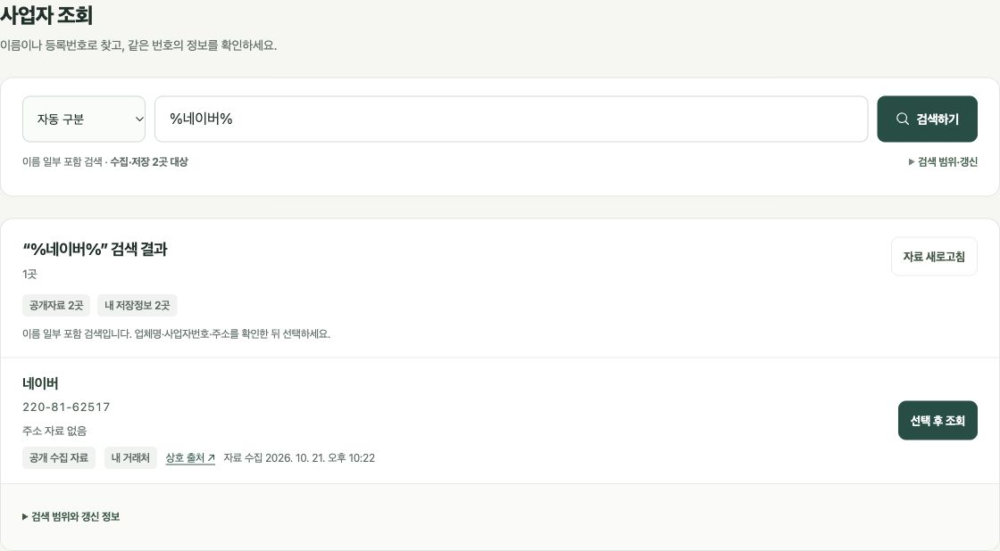

# 상호·업체명 검색

수정 기준: 2026-10-22 (한국시간). 검색 범위, 부분 일치 규칙과 저장된 확인 상호 연결을 설명합니다.

## 이름 검색이 되지 않았던 이유

2026-10-22 운영 화면에서 `이버`와 `박속`은 각각 네이버와 서해박속낙지전문점을 찾았지만, `%네이버%`는 0건으로 재현했습니다. 일반 포함 검색은 이미 있었고, 아래 범위 제한과 연결 누락이 함께 있었습니다.

| 항목 | 확인한 원인 | 이번 변경 |
| --- | --- | --- |
| 공개 데이터 범위 | 확인된 공개 상호가 네이버·서해박속낙지전문점 2곳에 한정 | 수집·저장 검색 대상 수를 검색창 바로 아래 표시. 전국 전체 이름 검색으로 안내하지 않음 |
| `%검색어%`, `*검색어*` | 기호 자체를 이름의 일부로 해석하여 0건 | `%`와 `*`를 임의 길이 문자열로 처리 |
| 저장한 공개 상호·대체 상호 | 거래처 이름만 색인하고 저장한 출처의 이름은 누락 | 상세와 같은 사업자번호 기반 공개정보 병합을 사용하여 확인 상호·대체 이름·주소를 검색에 반영 |
| 철회된 자동 상호 | 최신 자료에서 연결을 철회한 자동 이름이 개인 별칭으로 다시 들어감 | 출처 철회를 반영하고 실제 사용자 별칭과 자동 공개 이름을 구분 |

수집하지 않은 업체를 검색할 수 있게 된 것은 아닙니다. 국세청의 [사업자등록정보 진위확인·상태조회 API](https://www.data.go.kr/data/15081808/openapi.do)는 사업자번호를 이용한 확인 서비스이며, 전국 상호 목록을 검색해서 사업자번호를 반환하는 기능을 제공하지 않습니다. 전국 이름 검색을 위해서는 별도의 상호·사업자번호 검색 데이터 확보가 필요합니다.

## 사용 흐름

1. 사업자 조회의 통합 입력창에 **상호·업체명 또는 사업자등록번호**를 입력하고 `검색하기`를 누릅니다.
2. 이름 검색 결과에서 상호, 사업자번호, 제공된 주소·업종, 출처와 자료 수집 시각을 확인합니다.
3. 원하는 업체의 `선택 후 조회`를 누르면 해당 **사업자번호**로 기존 국세청 상태·과세유형과 공개 통합정보를 조회합니다.
4. 기존 `거래처에 저장` 또는 `내 사업으로 입력` 흐름을 이용합니다. 이름 검색 자체가 새 거래처를 자동 저장하지는 않습니다.

| 검색 기준 | 동작과 예시 |
| --- | --- |
| 이름·번호 자동 구분 | 기본값. 유효한 번호는 직접 조회하고, `서해박속`, `네이버`, `365마트` 등은 이름 검색 |
| 상호·업체명 | 이름으로 검색하도록 고정. `12345`처럼 숫자로만 된 상호도 이 모드 사용 |
| 사업자등록번호 | 번호 10자리와 검증번호 확인 후 기존 조회. 잘못된 번호는 오류 안내 |
| 기본 부분 일치 | `이버` → 네이버, `박속`·`낙지`·`전문` → 서해박속낙지전문점. 이름의 앞·중간·끝 모두 포함 검색 |
| 와일드카드 | `%네이버%`, `*네이버*`, `서해%전문점` 지원. `%`와 `*`는 0개 이상의 글자를 대신하며 입력 순서를 유지 |
| 이름 정규화 | 대소문자·Unicode 표현·공백 차이를 완화. `서해 박속`과 `서해박속` 검색 지원 |
| 법인 표시 | 이름 앞뒤의 `주식회사`, `(주)`, `㈜` 등 처리. 이름 내부의 같은 문자열은 무조건 삭제하지 않음 |
| 이름+지역 | `서해박속 광명`처럼 이름 일부와 공개된 주소를 함께 검색. 주소만 같다고 이름 일치로 처리하지 않음 |

정확한 이름, 이름 앞부분, 이름 일부, 이름과 주소 조합 순으로 결과를 정렬합니다. 결과는 화면에서 페이지로 나눠 확인합니다.

기본 검색에 이미 양쪽 포함 조건이 적용되므로 `%`를 붙일 필요는 없습니다. SQL 전체 문법을 실행하는 것은 아니며 `_`와 정규식 특수기호는 글자 그대로 취급합니다. `%`·`*`만 입력한 검색은 거부합니다. 초성·미완성 자모·오타 보정·한영 이름 자동 번역은 지원하지 않으며 영문 상호도 확인된 이름이나 저장한 별칭에 있어야 검색됩니다.

## 검색 범위와 동일 사업자 연결

| 대상 | 검색하는 이름 | 표시 |
| --- | --- | --- |
| 공개 수집자료 | 사업자번호 일치 또는 확인된 공식 도메인의 근거가 있는 상호·대체 이름 | `공개 수집 자료`, 상호 출처 링크, 자료 수집 시각 |
| 현재 거래처 | 현재 계정 또는 기기에 저장한 사용자 이름·별칭 + 동일 번호로 확인되어 저장된 공개 상호·대체 상호 | `내 거래처`, 저장된 확인 상호는 출처와 원래 수집 시각 |
| 내 사업 프로필 | 유효한 사업자번호와 함께 저장한 사업체명 + 저장된 확인 상호·대체 상호 | `내 사업 프로필`, 저장된 확인 상호는 출처와 원래 수집 시각 |

화면의 공개자료 수, 내 저장정보 수, 중복을 합친 검색 대상 수는 현재 불러온 자료로 계산합니다. **작성 시점의 공개 수집본은 서해박속낙지전문점과 네이버, 2곳입니다. 전국 모든 사업자가 수집된 상태는 아닙니다.** 이후 자료 추가·저장·계정 변경에 따라 표시 수가 달라집니다.

같은 사업자번호는 한 후보로 합치고 각 이름과 출처 구분을 유지합니다. 상호가 같아도 사업자번호가 다르면 별도 후보로 표시하며, 이름만으로 지점·회사·사업자 상태를 합치지 않습니다. 수집 설정의 이름이나 동일성 미확인 후보 이름은 확인된 공개 상호로 채택하지 않습니다.

현재 공개 목록과 저장한 자료는 상세 화면에서 사용하는 공통 사업자 연결 규칙으로 합칩니다. 저장한 출처만 있는 업체도 계정 안에서 검색할 수 있지만 공개 목록 건수에 추가하거나 공개 배포하지 않습니다. 다른 번호의 출처, 미확인 후보 상호, 동일성 정정으로 철회된 자동 이름은 확인 상호로 검색하지 않습니다.

검색 결과가 없다는 안내는 **현재 수집·저장된 범위에 결과가 없다는 의미**입니다. 미등록·폐업 판정이 아닙니다. 번호 조회, 같은 이름으로 거래처 등록, 사용자가 직접 누르는 외부 검색 링크를 제공합니다. 외부 검색 결과는 자동으로 특정 번호의 업체에 연결하지 않습니다.

## 갱신·오류·계정 분리

| 항목 | 구현 |
| --- | --- |
| 공개자료 갱신 | 기존 GitHub Actions 수집 일정인 **매일 06:17 한국시간**을 사용. 이름 검색용 별도 수집 일정을 만들지 않음 |
| 시각 표시 | 검색 범위 안내의 공개 목록 생성 시각과 각 업체의 자료 수집 시각을 구분. 수집 실패 시 마지막 자료의 시각을 새 시각으로 바꾸지 않음 |
| 캐시 | 불러온 공개 목록은 현재 탭에서 재사용. `자료 새로고침`으로 다시 요청 |
| 재요청 실패 | 오류 안내와 함께 기존 공개 목록이 있으면 유지하고, 내 저장정보는 계속 검색 |
| 자료 검증 | 중복 번호·잘못된 응답·과도한 크기 등을 검증하고 실패와 빈 목록을 구분 |
| 계정 전환 | 이름 검색·선택 상태와 개인 검색 색인을 초기화하고 전환한 계정·기기 자료로 다시 구성 |
| 뒤늦은 응답 | 새로운 검색·계정 전환 이후 완료된 이전 조회가 현재 선택 결과를 덮어쓰지 않도록 조회 순번 확인 |

이름 매칭은 브라우저 안에서 수행합니다. 검색을 실행하는 것만으로 이름·거래처 목록·메모를 외부 검색 서비스나 공개 수집 목록에 올리지 않습니다. 외부 검색 링크를 직접 누르면 해당 검색어가 외부 서비스로 전달됩니다. 후보를 선택한 뒤 상태를 조회할 때는 선택한 사업자번호를 기존 국세청 조회에 전달합니다. 개인 정보의 Firebase 저장·동기화는 기존 계정 저장 흐름을 따릅니다.

## 구현 파일과 로컬 검증

| 파일 | 역할 |
| --- | --- |
| `src/business-search.mjs` | 입력 분류·이름 정규화·색인·매칭·중복 처리 |
| `src/business-search-view.mjs` | 후보·검색 범위·출처·오류·페이지 렌더링, 문자열 이스케이프 |
| `src/business-profile.mjs` | 상세 화면과 공유하는 동일 사업자 공개정보 병합·이름 출처 규칙 |
| `src/enrichment.mjs` | 검증된 공개 목록과 개별 사업자 보강자료 로드 |
| `src/app.mjs` | 통합 입력·선택·기존 상세 및 저장 흐름·캐시·계정 전환 연결 |

아래 명령으로 검색 모델·결과 표시·자료 연결의 회귀 검증을 실행합니다. 배포 확인 결과는 이 문서 아래에 기록합니다.

```bash
node tests/business-search.test.mjs
node tests/business-search-view.test.mjs
node tests/enrichment.test.mjs
node tests/business-profile.test.mjs
```

검증 범위는 동명 업체의 다른 번호 유지, 같은 번호 병합, 확인되지 않은 이름 제외, 저장된 확인 상호·대체 상호, 철회된 자동 이름, 실제 사용자 별칭 보존, 와일드카드, 숫자 상호, 지역 조합, 페이지 처리, 계정별 색인 독립, HTML 문자열·URL 안전 처리, 오류·취소·크기 제한입니다. 로컬 검사 결과는 실제 국세청 인증 조회나 운영 배포 검증을 대신하지 않습니다.

### 2026-10-22 로컬 검증

- 이름 검색 모델 **19/19**, 이름 검색 결과 표시 **9/9** 통과.
- 전체 26개 테스트 파일을 개별 실행: **310개 중 309개 통과, 실패 0개, 건너뜀 1개**. 건너뛴 항목은 별도 Firestore 에뮬레이터가 필요한 보안 규칙 검사이며 이번 변경은 보안 규칙을 수정하지 않습니다.
- JavaScript 71개·JSON 6개 구문 및 import 확인, 공개 파일 33개 빌드, 변경 파일 공백 검사 통과.
- 실제 공개 목록으로 `이버`, `%네이버%`, `*네이버*`, `서해%전문점`, `광명 서해*전문점` 검색 확인. 공개 목록에 없는 `삼성`은 0건 유지.


### 운영 배포 및 실제 화면 검증

- 구현 커밋: [80263d3](https://github.com/softm/bizhannun/commit/80263d3e48f6820da19555a7e4efee43679ec29d).
- [GitHub Actions 배포](https://github.com/softm/bizhannun/actions/runs/39634533273): **2026-10-22 01:26 한국시간 성공**. CI에서도 310개 중 309개 통과·실패 0개·건너뜀 1개를 확인했습니다.
- [운영 사이트](https://softm.github.io/bizhannun/#lookup)를 새로 불러와 검색창의 실제 검색 대상 수 표시와 아래 입력을 확인했습니다.

| 운영 입력 | 확인 결과 |
| --- | --- |
| `%네이버%` | 네이버 1곳, 220-81-62517 |
| `*네이버*` | 네이버 1곳, 220-81-62517 |
| `서해%전문점` | 서해박속낙지전문점 1곳, 690-11-00416 |
| `광명 서해*전문점` | 이름과 주소가 함께 일치하는 서해박속낙지전문점 1곳 |
| `삼성` | 0곳, 현재 2곳만 검색했다는 범위 안내 표시 |
| `%` | 이름 입력 요청, 전체 목록 무조건 반환하지 않음 |

운영 이름 검색 점검에서 브라우저 콘솔 오류는 없었습니다. 저장된 공개 상호·별칭과 동일성 철회는 계정에 검증 자료를 추가하는 대신 테스트 fixture로 검증했습니다. 화면 증빙은 공개 업체의 검색 영역만 포함합니다.



관련 문서: [공개 수집·출처 안내](BUSINESS_ENRICHMENT.md), [Pages 운영 구조](PAGES_DIRECT.md), [국세청 공식 API 안내](https://www.data.go.kr/data/15081808/openapi.do).
