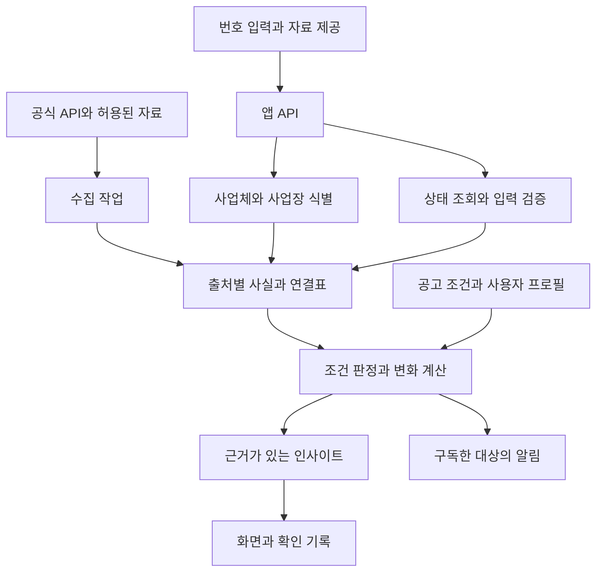

# 사업자한눈 — 사업자등록번호 기반 정보·인사이트 앱 기획서

- 기준일: 2026-10-19, 한국시간
- 서비스명: 사업자한눈(가칭)
- 문서 범위: 제품 방향, 공식 데이터 연결 범위, 인사이트 로직, 화면, 기술구조, 출시 순서
- 검증 수준: 공식 데이터 설명·개발가이드·공개 명세 검토. 인증키를 사용한 실제 업무 API 호출, 데이터 누락률 측정, 계정 승인, 유료 계약은 수행하지 않음.
- 아래 가격·기간·성과 목표·화면 숫자는 기획 가안이며 실제 사업 실적이나 시장 통계가 아님.

## 1. 제품의 핵심 결정

**사업자번호를 출발점으로 거래 전에 확인할 사항, 내 사업에 맞는 기회, 다음에 할 일을 알려주는 앱을 만든다.**

사업자번호만으로 모든 기업의 상호·주소·재무를 알아내는 것을 제품 약속으로 삼지 않는다. 국세청에서 확인할 수 있는 상태와 다른 기관의 공개기록, 사용자가 제공한 프로필을 각각 근거와 함께 연결한다.[S1]

| 항목 | 기획 결정 |
|---|---|
| 첫 고객 | 매달 거래처 등록·계약·정산 확인을 반복하는 소기업 사업주·담당자, 기존 지원한눈 이용자 |
| 진입 방식 | ‘거래처 확인’과 ‘내 사업 등록’을 첫 화면에서 선택 |
| 무료 핵심 | 단건 사업자 상태 조회, 연결 가능한 공개정보, 출처·조회시각 |
| 첫 유료 가설 | 거래처 목록 일괄 확인, 확인 기록 저장, 변화 알림, 비교·내보내기 |
| 내 사업의 가치 | 사업자 프로필을 지원한눈과 연결해 공고별 충족조건·미확인조건·준비사항 표시 |
| 확장 방식 | 통신판매·음식점·조달업체·돌봄기관 등 실제 고객 업종별로 데이터팩 추가 |
| 성공 기준 | 사용자가 실제 확인 업무를 반복해서 처리하고, 확인 누락과 소요시간이 줄어드는가 |

기존 NICE BizAPI도 사업자 인증·거래처 심사·서류 제출 연계를 제공한다. 단순 기업정보 조회 자체만으로 차별화하기 어렵다는 것이 본 기획의 판단이다. 차별점은 **기록을 설명하고 업무를 마무리하는 경험**, 기존 지원한눈·돌봄한눈과의 연결에 둔다.[S18]

## 2. 정보 접근 범위

| 구분 | 접근 방식 | 대표 정보 | 앱에서의 표현 |
|---|---|---|---|
| A. 번호 직접 조회 | 공개 API의 사업자번호 검색 | 국세청 상태, 해당 등록업체의 통신판매·조달 정보 | ‘사업자번호로 확인’ |
| B. 식별번호 연결 | 사업자번호를 법인·공시·허가·기관번호와 매핑 | 기업개황, 공개재무, 인허가, 기관 운영정보 | ‘공개기록 연결’, 매칭 근거 표시 |
| C. 프로필과 결합 | 업종·지역·업력·규모 등 추가 입력 | 지원사업 조건, 주변 업소·인구, 업종 비교 | ‘입력정보 기반 분석’ |
| D. 동의·계약·서류 | 적법한 접근권한, 기관 인증, 제공사 계약 | 본인 세무·매출·계좌, 유료 신용정보, 일부 증명·등기 | ‘본인 연동’ 또는 ‘계약 데이터’ |

이 구분은 데이터의 진실성을 단순히 서열화하는 점수가 아니다. 정보가 어디에서 왔고 어떤 범위에서 쓸 수 있는지 설명하기 위한 제품 설계다.

### 2.1 번호만 입력했을 때

국세청 상태조회는 사업자 운영상태, 과세유형, 폐업일 등 제한된 필드를 제공한다. 진위확인은 번호에 개업일과 대표자명 등을 추가하여 입력값의 일치를 대조한다. 상호·대표자·주소를 전국 사업자에 대해 역조회하는 기능과 다르다.[S1]

| 사용자 입력 | 가능한 결과 | 별도로 남는 문제 |
|---|---|---|
| 사업자번호 | 공개 상태 확인 | 상호·주소·업종이 확보되지 않을 수 있음 |
| 번호+공개 기업기록 연결 | 해당 업체의 기본정보·공개기록 보강 | 출처 대상에 속하지 않는 사업체는 보강 불가 |
| 사업자등록증 촬영/OCR | 문서에서 상호·주소·업종·개업일 입력 보조 | OCR 자체는 문서 원본 진위나 소유자 인증이 아님 |
| 본인 확인·자료연동 | 허용된 범위의 내 사업 정보 분석 | 연동 목적·항목·권한·보유기간을 개별 설정 |

번호를 입력하거나 등록증을 가지고 있다는 이유만으로 ‘해당 사업자의 대표자/관리자’ 권한을 부여하지 않는다.

## 3. 연결할 정보 전체 지도

전국 모든 업종·기관을 단일 API로 포괄할 수 없으므로, 아래는 실용적인 전체 범주 지도다. ‘확인’은 공식 문서상 제공 범위를 확인했다는 뜻이며 개별 사업체의 실제 조회 성공을 뜻하지 않는다.

| 정보 범주 | 얻을 수 있는 내용 | 연결 방식·자료 범위 | 기획 단계 |
|---|---|---|---|
| 사업자 상태·과세 | 계속·휴업·폐업 등 상태와 과세 관련 정보 | 국세청 사업자번호 조회 [S1] | 1차 |
| 기본 기업정보 | 회사명, 대표자, 설립일, 주소, 업종 등 | 금융위의 법인번호·회사명 조회, DART 공시번호 연결. 보유 자료가 있는 기업 [S3][S4] | 1차 보강 |
| 법인·계열 구조 | 법인번호, 계열·연결대상 종속기업 등 | 금융위·공시자료의 제공 범위 [S3] | 후속 |
| 재무정보 | 매출·이익·자산·부채·자본, 재무 추이 | 공개 재무가 있는 법인. 공시 기업 일부 및 금융위 일부 비외감법인 [S5][S6][S7] | 2차 |
| 고용 규모의 단서 | 국민연금 가입자수·월별 변화·고지금액 | 사업장명·일부 사업자번호·주소 대조. 공개기준을 충족하는 사업장 [S8] | 2차 |
| 통신판매 신고 | 등록업체명, 신고일, 신고상태 등 | 사업자번호 직접조회 가능한 FTC 등록업체 [S2] | 1차 |
| 통신판매 상세 명부 | 대표자, 사업장주소, 도메인, 취급품목, 공개 연락처 등 | 사업자번호가 포함된 FTC CSV. 일부 연락처는 비식별 처리 [S26] | 1차 보강 |
| 방문판매 등 특수판매 | 업종별 공개 등록정보 | 서비스별 명세·범위 확인 후 추가. 모든 판매자를 포괄한다고 전제하지 않음 | 확장 후보 |
| 조달업체 등록 | 나라장터 업체 기본정보, 등록업종, 공급물품 | 나라장터 등록업체의 사업자번호 [S9] | 조달 고객용 1차 선택 |
| 공공조달 제재 | 제공 범위의 현재 유효한 부정당 제재 | 등록업체·제재상태의 제공 제한 존재. 전체 과거이력과 구분 [S9] | 조달 고객용 |
| 낙찰·계약 활동 | 공개 낙찰·계약, 계약 상대기관, 기간·금액 | 공개 공고·기간별 수집 후 업체번호로 연결 [S10][S11] | 2차 |
| 일반 인허가 | 음식점 등 업종별 허가·영업상태·주소·이력 | 관리번호, 상호·주소·업종으로 매칭. 보편적인 사업자번호 키는 아님 [S12][S13] | 업종별 2차 |
| 의료기기 유통업체 | 사업장·허가·폐업 관련 정보 | 해당 식약처 자료에 사업자번호 항목 제공 [S19] | 돌봄·의료 팩 |
| 식품·의약품 처분 | 해당 업종·제품의 공개 행정처분·회수 기록 | 허가번호·업체명·주소로 식별. 처분의 대상·기간·상태 구분 [S22][S23] | 업종별 후속 |
| 공장·생산품 | 지자체별 공장주소·업종·생산품 등 | 일부 지역 자료는 사업자번호 포함, 누락 가능. 전국 동일 제공 아님 [S24] | 제조업 팩 |
| 상가·경쟁점 | 상호·업종·주소·좌표·주변 분포 | 상가업소번호 별도. 사업장 식별 또는 위치기반 집계 [S14] | 2차 |
| 지역 수요 배경 | 지역별 인구·가구·연령구성 등 | 주소→행정구역/좌표→SGIS 통계. 기업 개별 데이터가 아님 [S15] | 2차 |
| 지원사업·정책 | 지원조건, 접수기간, 신청방법, 원문·첨부 | 내 사업 프로필과 기업마당·K-Startup 공고의 조건 결합 [S16][S17] | 1차 |
| 돌봄기관 운영정보 | 기관 기본·시설·운영 관련 공개 정보 | 장기요양기관코드를 별도 관리하고 사업체와 확인 후 연결 [S20] | 기존 돌봄한눈 확장 |
| 특허·상표·인증 | 기술·권리·인증의 존재·유효성 검토 | KIPRIS Plus 등 상품·번호 매핑·이용계약 확인 후. 출원과 현재 권리 보유를 구분 [S21] | 후속 명세 검증 |
| 홈페이지 표시정보 | 사업자가 공개한 상호·번호·주소·도메인 | 확인된 공식 홈페이지 또는 사용자 제공 URL의 표시정보와 대조 | 후속 정책 검토 |
| 세무·매출·계좌 | 본인 제공 또는 인증 연동한 사업 자료 | 공개 번호조회와 별도. 필요한 서비스와 권한 확보 후 설계 | 동의 기반 후속 |
| 신용·연체·등기 | 제공사 계약 또는 서류 발급으로 확인되는 항목 | NICE 등 계약 범위, 기관별 공개·발급 범위 확인 [S18] | 유료 확장 |

세금 체납·대출·대표자 개인신용·전 거래내역·전 소송이력을 사업자번호만으로 모두 조회할 수 있다고 약속하지 않는다. 일부 공개명단·공시·유료정보의 존재와 특정 업체의 전체 내역을 아는 것은 별개다.

## 4. 실제 API 연동에서 중요한 차이

| 출처 | 구현 시 적용할 규칙 |
|---|---|
| 국세청 | 활용신청·인증키 필요. 문서상 한 요청에 최대 100개 번호. 갱신 간격과 신규 사업자 반영 지연을 고려해 조회실패·미등록 응답을 폐업으로 처리하지 않음 [S1] |
| 금융위 기업기본 | 법인번호 또는 법인명으로 조회하고 응답의 사업자번호·공시 식별정보로 내부 연결표 구성. 사업자번호 응답 필드의 존재를 직접 검색 지원으로 혼동하지 않음 [S3] |
| DART 기업개황 | 입력은 corp_code, 응답에 bizr_no·jurir_no. 고유번호 전체 파일만으로 사업자번호 매핑이 완성되지 않으므로 기업개황 또는 다른 공식 연결자료 보강 [S4][S25] |
| 금융위 재무·DART 재무 | 회계연도·분기/누적·연결/별도·단위를 일치시킨 데이터만 비교. 정정공시와 재무자료 존재 여부를 고려 [S5][S7] |
| 국민연금 | 전체 사업자번호 공개를 전제하지 않고 사업장명·주소를 함께 대조. 화면 명칭은 ‘국민연금 가입자 수’. 실제 전체 직원·퇴사율·평균연봉과 구분 [S8] |
| FTC | 등록현황에서 사업자번호로 검색. 등록상세와 변경정보는 서비스별 활용신청·명세 확인. 빈 결과는 해당 출처 미확인 [S2] |
| 나라장터 | 업체·업종은 번호 조회, 낙찰·계약은 기간·공고 중심 수집 후 연결. 공동수급·변경계약·총액/차수액 중복을 방지 [S9][S10][S11] |
| 인허가 | 2026년 공공데이터포털 통합 공개 경로를 기준으로 개발. 자료마다 좌표계 확인; 일반음식점 예시는 EPSG:5174 [S12][S13] |
| 기업마당 | 신규 API에 제3유형(출처표시·변경금지)이 표기되어 있으므로 원문·첨부 가공 및 AI 요약·재배포 범위를 확인. 운영승인도 별도 확인 [S16] |
| K-Startup | 최신 공고 API의 신청조건과 제공 필드 사용. 예비창업자는 번호 없이도 프로필 입력 경로를 제공 [S17] |

국민연금은 문서상 법인 가입자 3명 이상, 개인 가입자 10명 이상(2025년 7월 이후)이 대상이다. 납부재개·납부예외와 소득상한 때문에 인원 변화와 고지액을 실제 입퇴사·급여로 그대로 해석할 수 없다.[S8]

API 메타데이터의 ‘실시간’과 원천 사실의 갱신주기는 다를 수 있다. 예를 들어 금융위는 실제로 실시간 서비스가 아니라고 별도로 설명한다.[S3][S5]

FTC 지역별 CSV는 매주 일요일 오전 갱신한다고 설명한다. 이 자료로 사업자번호와 공개 상세정보의 검색 인덱스를 보강할 수 있다. API와 CSV의 기준시점을 따로 저장하고, 비식별 처리된 연락처는 그대로 유지한다. CSV 항목이 등록현황 API에 모두 반환된다고 가정하지 않는다.[S26]

## 5. 사용자에게 주는 핵심 인사이트

아래 문구와 숫자는 기능 설명용 가상 예시다.

| 기능 | 결합하는 정보 | 인사이트 예시 | 다음 행동 |
|---|---|---|---|
| 거래 전 정보 대조 | 상태+사용자 문서+공개 프로필 | ‘사업자 상태는 확인했습니다. 계약서 주소와 공개자료 주소가 달라 확인이 필요합니다.’ | 두 출처 비교, 최근 증빙 확보, 확인 기록 저장 |
| 정산 전 일괄 확인 | 저장 거래처+현재 상태+직전 확인값 | ‘관리 업체 30곳 중 상태 변화 1곳, 조회 실패 2곳이 있습니다.’ | 변화 확인, 실패 재조회, 확인 완료 기록 |
| 내 사업 지원조건 진단 | 지역·업종·업력·규모+공고 원문 | ‘지역과 업력은 부합합니다. 매출·상시근로자 조건은 확인이 필요합니다.’ | 미확인 항목 입력, 준비서류·원문 열기 |
| 기록 불일치 설명 | 세무 상태+인허가 상태+기준일 | ‘세무 등록은 유지되지만 연결된 허가에는 과거 폐업 기록이 있습니다.’ | 같은 사업장인지 확인, 현재 허가 선택 |
| 공개 재무 변화 | 동일 범위·기간의 공개재무 | ‘공개 매출은 늘었지만 이익률은 낮아졌습니다.’ | 원재무 확인, 비용 구조를 검토할 질문 제시 |
| 조달 기회 발견 | 등록업종·지역·물품+신규 공고 | ‘검토할 입찰 후보가 있습니다. 면허·실적·인력 조건을 확인하세요.’ | 조건 대조, 원문·첨부 확인 |
| 상권 변화 | 위치·업종+상가+인허가 이력+인구 | ‘주변 동종업체의 신규 인허가가 늘었습니다.’ | 비교기간·반경 변경, 경쟁 구성 확인 |
| 돌봄기관 운영 분석 | 기관 프로필+지역 고령인구+공급시설 | ‘권역별 서비스 분포와 인구 배경을 비교할 수 있습니다.’ | 권역 비교, 지원공고·협력업체 확인 |

### 우선 개발할 인사이트 3개

1. **거래처 등록·정산 전 확인:** 공개 사실과 문서 간 차이를 확인하고 기록을 남긴다.
2. **조건이 설명되는 지원사업 추천:** 사용자에게 맞는 이유와 빠진 정보를 알려준다.
3. **확인된 변화 알림:** 관심 업체·공고의 변화가 생기면 바뀐 값과 출처를 알려준다.

가입자 감소→부도, 정상사업자→안전, 인허가 보유→품질 보증처럼 근거 없는 연결은 만들지 않는다.

## 6. 추천과 분석 로직

### 6.1 지원사업 조건 판정

| 요소 | 설계 |
|---|---|
| 입력 프로필 | 사업장 위치, 업종과 코드체계, 개업일, 기업유형, 매출 기준연도·금액, 상시근로자 기준·인원, 필요 시 인증·수혜이력 |
| 공고 구조화 | 필수조건, 선택조건, 제외조건, AND/OR 관계, 기준일, 접수기간, 서류, 원문 위치 |
| 판정 값 | 공개조건 부합 / 조건 불충족 / 추가 확인 필요 |
| 판정 순서 | 조건 논리식을 평가하고, 불충족·미확인 여부를 반영한 후 관련성·마감·준비가능성으로 정렬 |
| 미확인 처리 | 정보가 없으면 ‘확인 필요’. 빈 값을 0이나 ‘충족’으로 변환하지 않음 |
| 날짜 규칙 | 업력 판단은 공고가 정한 기준일 사용. 사업자등록일·설립일·공고상 창업일을 무조건 동일시하지 않음 |
| 결과 근거 | 공고 조건, 사용된 프로필값과 출처, 비교 결과, 원문·기준일 |
| 최종 한계 | 공개된 조건에 대한 사전 점검이며 기관의 자격심사·선정·지원금 확정과 별개 |

추천점수를 사용하더라도 선정 확률처럼 표시하지 않는다. ‘확인한 조건 6개, 미확인 조건 3개’처럼 확인 범위 자체를 보여주는 방식이 좋다.

### 6.2 상태 변화 판정

- 각 출처의 마지막 성공 응답과 새 성공 응답을 같은 필드·대상 기준으로 비교한다.
- 타임아웃, 인증키 오류, 제한 초과, 빈 응답은 변경 이벤트로 만들지 않는다.
- 알림에는 이전 값·새 값·관측시각·원천일자를 포함한다.
- 앱이 처음 관측한 날짜를 실제 변경 발생일로 바꾸지 않는다.
- 동일 변경을 반복 발송하지 않도록 이벤트 식별자와 발송 이력을 둔다.
- 필요 시 변화 재확인 후 알림하고, 재확인 정책에 따른 지연을 제품에 반영한다.
- 사용자가 알림을 선택한 대상·채널·주기만 운영한다.

### 6.3 재무와 상권 분석

| 분석 | 계산 가능 조건 | 표시할 한계 |
|---|---|---|
| 매출 증가율 | 동일 회계범위·기간의 전기와 당기 | 기준이 0이면 일반 증가율 대신 산출불가/기저 설명 |
| 영업이익률 | 매출과 영업이익이 같은 기간·범위 | 연결·별도, 단위, 공시 기준일 표시 |
| 공개 기업 비교 | 동일 업종·규모·기간의 충분한 표본 | ‘전체 업계 순위’가 아닌 ‘공개자료 표본 내 비교’ |
| 주변 업체 밀도 | 업종 분류·공간범위·기준일 일치 | 개별 업체 매출·수익성으로 해석 불가 |
| 개폐업 변화 | 인허가 이력과 사업장 식별이 검증됨 | 목록에서 사라짐만으로 폐업 판정 금지 |
| 고령인구 대비 돌봄 공급 | 같은 권역·시점의 통계와 기관 자료 | 잠재수요 배경이며 입소대기·실제 수요의 확정값 아님 |

## 7. 화면과 사용 흐름

### 7.1 시작 화면

두 개의 진입 버튼을 제공한다.

- **거래처 확인:** 번호 입력 → 공개 상태 → 연결정보 → 확인사항 → 거래처 저장.
- **내 사업 등록:** 번호 입력 → 부족한 프로필 입력/OCR → 필요한 조건 확인 → 지원사업·업종별 인사이트.

거래처 확인에서 사용자 본인 매출이나 직원 수를 필수로 요구하지 않는다. 상호·주소가 확보되지 않은 경우 ‘추가 정보 입력’ 또는 ‘등록증에서 가져오기’를 즉시 제공한다.

### 7.2 결과 화면

| 영역 | 내용 |
|---|---|
| 상단 프로필 | 업체명(확인된 경우), 번호, 사업장 선택, 확인시각 |
| 현재 확인사항 | 상태 변화, 출처 간 차이, 아직 확인되지 않은 항목 |
| 요약 카드 | 확인된 정보, 비교할 기록, 다음 할 일 |
| 상세 탭 | 기본정보 / 등록·허가 / 재무·규모 / 지원사업 / 지역·상권 / 변경기록 |
| 근거 보기 | 출처명, 원문, 원천 기준일, 조회시각, 연결 방식 |
| 행동 버튼 | 거래처 저장, 다시 확인, 비교, 확인 완료, 원문 열기 |

자료가 없는 재무·고용 탭은 빈 그래프를 만들지 않는다. ‘해당 공개자료 없음’과 ‘조회 실패’를 구별해 설명한다. 색상만으로 상태를 전달하지 않고 텍스트·아이콘을 함께 쓴다.

### 7.3 거래처 관리 화면

| 기본 열 | 작업 |
|---|---|
| 업체명·번호·태그·담당자 | 검색, 태그 필터, 중복 병합 검토 |
| 마지막 확인일·현재 상태 | 오래된 확인만 재조회 |
| 변화·미확인 항목 | 상태 변화와 기술적 조회 실패를 분리 |
| 사용자가 남긴 기록 | 계약 전 확인, 월 정산 전 확인, 다음 확인일 |
| 내보내기 | 허용된 정보와 출처를 함께 PDF/CSV로 정리 |

공개 업체정보와 사용자의 거래관계·메모·거래금액은 별도 권한으로 관리한다. 기본 공유범위는 소유자에게 제한한다.

## 8. 다른 업체를 잘못 연결하지 않는 설계

### 8.1 사업체와 사업장 구분

법인·사업자등록·사업장·허가·기관번호를 별도 엔터티로 관리한다. 한 법인에 여러 사업장이나 등록·허가가 연결될 수 있으므로 단일 행으로 억지로 합치지 않는다.

| 식별자 | 용도 |
|---|---|
| 사업자등록번호 | 세무 등록과 직접 대응하는 자료 연결 |
| 법인등록번호 | 법인 단위 자료 연결 |
| DART corp_code | 공시·공개재무 연결 |
| 인허가 관리번호 | 허가별 현재 기록과 이력 연결 |
| 상가업소번호 | 상권 자료 속 점포 연결 |
| 장기요양기관코드 | 기관 단위 돌봄자료 연결 |
| 내부 organization_id / establishment_id | 출처별 식별자를 안전하게 묶는 내부 기준 |

### 8.2 매칭 단계

1. 공인된 전체 식별번호가 정확히 일치하면 대응 근거를 저장한다.
2. 기존에 검증된 교차 식별자 연결표가 있으면 활용한다.
3. 상호·주소·업종·등록시기만 유사하면 후보로 제시한다.
4. 본사·지점·이전주소·복수허가가 섞이면 사업장 선택을 받는다.
5. 연결 근거가 부족하면 미확인으로 남긴다.

같은 주소의 여러 사업자, 같은 상호의 서로 다른 회사, 법인명 변경, 합병, 사용자 입력 오류를 반드시 처리한다. 업종도 국세청·표준산업분류·상권업종의 코드체계와 버전을 따로 저장한다.

### 8.3 사실 단위의 출처 보관

각 값에 source_id, source_record_id, source_url, observed_at, effective_at 또는 기준기간, match_method, visibility, license_policy를 연결한다. 상충하는 값을 덮어쓰지 않고 사용자가 출처별로 볼 수 있게 한다.

## 9. 데이터 처리 구성도

아래는 제안 아키텍처이며 구현 완료 상태를 뜻하지 않는다.

실시간 번호조회와 대량 공개자료 수집을 분리한다. 상태조회부터 먼저 보여주고, 다른 자료는 준비된 카드부터 채운다. 일부 기관 장애가 전체 결과를 막지 않도록 출처별 성공·실패·오래됨 상태를 유지한다.

## 10. 권장 기술구조

사용자의 Node.js/TypeScript·React 경험과 기존 정보서비스를 재사용하는 방향의 제안이다. 특정 서비스 가입이나 배포를 진행한 상태는 아니다.

| 구성 | 제안 | 이유 |
|---|---|---|
| 프런트엔드 | React + TypeScript 반응형 웹, 이후 PWA/앱 연결 | 입력·비교·표·모바일 이용 지원 |
| 앱 API | Node.js + TypeScript | 키 보호, 조회 통합, 권한·호출량 제어 |
| 데이터베이스 | PostgreSQL, 공간분석 도입 시 PostGIS | 식별자 연결, 출처·이력, 지역검색 |
| 수집·변경 작업 | 별도 작업 큐와 스케줄러 | 사용자 조회와 대량 수집 분리 |
| 문서 처리 | 업로드 검사 → OCR → 사용자 확인 | 오인식된 번호·날짜를 자동 확정하지 않음 |
| 분석 | 규칙·SQL/코드 계산을 우선 | 상태·금액·조건을 재현 가능하게 계산 |
| AI | 허용된 자료에서 조건 추출 후보·설명·질문 생성 | 근거를 읽기 쉬운 문장으로 전달 |
| 문서 보관 | 권한이 적용된 객체 저장소, 목적별 보유기간 | 등록증·내부 기록 노출 방지 |
| 운영 관측 | 출처별 지연·실패·쿼터·필드누락·연결률 | 데이터 품질을 실제 운영 지표로 관리 |

공개 페이지는 정적으로 제공할 수 있지만 인증키, 개인정보, 사용자 거래처 목록, 주기조회 작업은 서버 영역에 둔다. GitHub Pages 등 정적 호스팅만으로 모든 기능을 처리하는 구조는 선택하지 않는다.

### 최소 저장 모델

| 모델 | 주요 역할 |
|---|---|
| organizations | 법인·사업체의 내부 기준 |
| establishments | 실제 사업장·지점·위치 |
| registrations | 사업자번호·법인번호·공시번호·허가·기관코드 |
| source_records | 출처 원본 식별자, 허용된 원문/구조화 결과, 버전 |
| facts | 필드별 값·대상·기간·출처·공개범위 |
| entity_links | 연결 근거·검토상태·유효기간 |
| business_profiles | 사용자 확인 프로필, 본인·관리권한 구분 |
| programs / program_rules | 공고별 원문 버전과 구조화 조건 |
| insights | 규칙버전, 입력 근거, 계산 결과, 추천 행동 |
| watchlists / check_runs | 거래처 목록과 일괄 확인 작업·결과 |
| change_events / notifications | 확인된 변경과 중복 없는 알림 |
| access_grants | 소유자·팀 접근권한, 자료연동 동의·철회 |

### API의 책임 예시

- POST /business-lookups: 조회 작업 생성, 출처별 결과 반환.
- POST /business-profiles: 사용자 입력 프로필 저장.
- POST /documents/extract: OCR 결과를 확인 가능한 초안으로 반환.
- GET /businesses/{id}/evidence: 필드와 출처·기준일 조회.
- POST /watchlists/{id}/checks: 관리 거래처 일괄 확인.
- GET /businesses/{id}/opportunities: 프로필 조건으로 추천과 미확인 사항 조회.
- POST /insights/{id}/acknowledgements: 확인·보류·후속작업 기록.

위 경로는 내부 API 설계 예시다. 외부기관의 실제 엔드포인트를 뜻하지 않는다.

## 11. AI 적용 범위와 원문 일치

| AI가 할 일 | 규칙·검증이 할 일 |
|---|---|
| 허용된 공고에서 조건을 구조화하는 초안 | 날짜·금액·AND/OR·예외조건 검증 |
| 여러 출처의 차이를 설명 | 어떤 업체·사업장인지 식별 확정 |
| 사용자에게 필요한 추가 질문 제안 | 상태코드·변화·재무 수식 계산 |
| 조회 근거를 읽기 쉬운 문장으로 정리 | 출처와 연결되지 않는 사실·수치 차단 |
| 다음 행동 체크리스트 초안 | 접근권한·공개범위·알림 조건 적용 |

각 인사이트는 제목, 근거, 해석, 미확인 항목, 추천 행동, 기준일, 규칙/모델 버전을 가진다. 근거가 없는 매출·사기확률·지원금 수령액을 생성하지 않는다.

지원사업의 원문 일치를 특히 중요하게 다룬다.

1. source + source_notice_id를 공고의 기준키로 사용한다.
2. 제목·본문·첨부·신청URL이 같은 공고와 같은 버전인지 확인한다.
3. 서로 다른 출처의 제목과 본문을 유사도만으로 섞지 않는다.
4. 출처 원문과 앱의 분석을 화면에서 구분한다.
5. 공고 수정·취소·연장 시 기존 추천을 다시 계산한다.
6. 가공 허용범위가 불명확하면 해당 자료의 AI 요약·첨부 재배포를 기능별로 비활성화하고 허용된 표시와 원문 연결을 제공한다.
7. 원문 안의 문구는 데이터로 처리하며, AI가 따라야 할 시스템 명령으로 해석하지 않는다.

## 12. 기존 프로젝트와 결합

| 기존 서비스 | 사업자한눈과 공유할 부분 | 사용자에게 생기는 이점 |
|---|---|---|
| 지원한눈 | 공고 ID·원문·분야·기간·조건, 내 사업 프로필 | 매번 같은 지역·업종을 입력하지 않고 추천 이유와 준비조건 확인 |
| 돌봄한눈 | 장기요양기관코드·주소·서비스 유형·공식정보 | 운영자용 권역분석, 공급업체 확인, 관련 지원사업 |
| 토지한눈 | 사업장 주소·좌표를 통한 후속 링크 | 입지·건축·토지 관련 확인으로 이동. 구체 데이터·자동판정은 별도 검증 |

공고·기관 데이터를 각 앱에서 다시 수집해 중복 보관하기보다 공통 데이터 서비스에 원출처 ID와 버전을 두고 재사용한다. 사용자 민감정보를 서비스 간 자동 공유하지 않고 필요한 목적과 권한에 따라 연결한다.

농업인 확장은 일반 사업자등록과 농업경영체 등록의 차이를 별도로 처리해야 한다. 사업자번호만으로 농업경영체 보유·자경·정책자격을 확정하는 기능은 범위에 넣지 않는다.

## 13. 출시 순서

**권장 MVP는 번호조회·프로필 보완·거래처 일괄확인·지원한눈 연결이다.**

| 단계 | 구현 범위 | 완료 기준 |
|---|---|---|
| 0. 데이터 검증 | API 신청, 개인/법인 표본 조회, 식별번호 연결 검증 | 어떤 유형에서 어떤 필드가 채워지는지 수치화, 오결합 사례 수정 |
| 1. 기본 조회 | 국세청 상태, FTC 보강, 법인 공개 프로필 선택 연계, 출처·기준일, 입력/OCR | 실제 조회와 미확인·실패 화면 분리, 상호 없는 결과도 정상 처리 |
| 2. 반복 업무 | 거래처 저장·태그, CSV 일괄등록, 일괄 확인, 확인 기록, 변화 알림 | 중복번호·부분실패·재시도·알림중복 방지 |
| 3. 내 사업 기회 | 프로필, 지원한눈 연결, 공고 조건 판정, 준비사항 | 원문 일치, 조건별 근거, 미확인 처리가 검증됨 |
| 4. 업종별 확장 | 음식점 인허가·상권 또는 조달 정보 중 수요가 확인된 하나 | 대상 업종의 오결합·기준일·이력 검증 |
| 5. 고급 분석 | 공개 재무·국민연금·돌봄기관 팩·유료데이터 | 각 자료 해석 한계와 비용·계약이 제품에 반영됨 |

**기간 가안:** 기존 공고 수집 기반을 재사용하는 숙련 개발자 1명을 가정하면 0~3단계의 제한된 MVP에 약 6~8주를 계획한다. 기관 운영승인, 유료 계약, 대규모 식별자 정비, 네이티브 앱 심사는 이 추정에 포함하지 않는다. 표본 실호출 결과에 따라 일정을 다시 잡는다.

초기 데이터팩은 고객에 맞춰 하나만 고른다. 통신판매 고객이면 FTC를, 정기 납품·공공조달 고객이면 나라장터 업체정보를 먼저 깊게 연결한다.

## 14. 출시 전 확인할 실험

아래 목표는 이 프로젝트의 초기 의사결정용 가안이다.

| 실험 | 진행 방법 | 통과 기준 가안 |
|---|---|---|
| 데이터 충실도 | 사용자가 제공한 업체 50~100개를 유형별로 점검 | 번호만·추가입력 후 정보확보율을 각각 기록 |
| 업체 연결 정확성 | 동명, 이전주소, 지점, 다중허가 포함 수동 대조 | 검토 표본에서 잘못된 자동확정 연결 0건. 미확인은 허용 |
| 기본 사용성 | 두 진입 목적별 5명씩 실제 작업 관찰 | 각 집단 5명 중 4명 이상이 설명 없이 첫 결과 도달 |
| 추천 정확성 | 5개 프로필과 30~50개 공고를 사람이 대조 | 확인되지 않은 조건을 충족으로 바꾸는 사례 수정 완료 |
| 장애·변경 처리 | 빈 응답·지연·키오류·정정공시·상태변화 시나리오 | 기술적 실패가 폐업·제재·자격변경 알림으로 전환되는 사례 0건 |
| 반복 이용 | 실제 업무 이용자 10명에게 4주간 사용 | 5명 이상이 실제 업무에 두 차례 이상 재사용 |
| 지불의사 | 이용자에게 명시한 가격으로 유료 사용 제안 | 3명 이상 실제 유료 선택 시 다음 투자 검토 |

사건이 거의 변하지 않아도 ‘월 정산 전 확인’과 ‘확인기록 보관’이 반복 사용되는지 확인한다. 알림 빈도만으로 제품 가치를 평가하지 않는다.

## 15. 수익모델과 비용

가격은 시장조사를 거친 확정 판매가가 아니라 실험용 제안이다.

| 요금제 | 가격 가안 | 핵심 제공 |
|---|---|---|
| 무료 | 0원 | 단건 상태·공개정보 확인, 제한된 저장 |
| 개인·소사업자 | 월 9,900원 | 거래처 목록, 월 정산 전 일괄확인, 확인 기록, 변화 알림 |
| 업무용 | 월 29,000원 | 확대된 관리규모, 비교·내보내기, 담당자·기록 공유 |
| 기관·플랫폼 | 별도 견적 | 대량 확인 API, 조직권한, 운영 지원 |
| 전문 데이터 | 별도 과금 | 공급계약이 허용하는 신용·등기·전문정보 조회 |

공공데이터 자체를 무조건 재판매하는 구조로 설계하지 않는다. 관리 업무·기록·맞춤 분석에 가치를 두고, 원데이터 재이용 조건을 반영한다.

월 운영비는 서버·DB·저장공간, OCR/AI 처리량, 알림 채널, 유료정보 조회, 데이터 정정·운영 비용으로 나누어 측정한다. 초기에는 문서 전체를 매번 AI에 보내기보다 조건 초안을 한 번 만들고 원문 변경 시 다시 계산한다.

호출량 계획은 ‘활성 사용자 수 × 관리 업체 수 × 확인 빈도’를 출처별로 계산한 다음, 같은 공개 업체의 중복 조회를 줄여 산정한다. 중복 조회 절감 과정에서도 사용자별 거래처 목록과 메모는 서로 노출하지 않는다.

광고가 들어가더라도 검색·추천·확인상태와 광고를 명확히 표시한다. 광고비로 업체의 신뢰도를 높이는 구조는 채택하지 않는다.

## 16. 운영 정책에 반영할 사항

이 절은 실제 데이터 결합 기능을 운영하기 위한 제품 정책이다.

- 원출처·원천 기준일·조회시각을 구분하여 보여준다.
- 번호 형식검사, 상태확인, 입력 진위대조, 본인/대표권 인증을 별도 단계로 둔다.
- 개인정보·주소·전화번호는 목적에 필요한 공개범위만 표시하고 정정요청 경로를 제공한다.
- 등록증·계약정보·거래관계·내부 메모는 기본 비공개로 보관한다.
- 등록증 원본은 추출 후 보유 필요를 선택하게 하고 불필요한 부분의 처리를 최소화한다.
- 제공사별 이용조건을 저장·가공·공유·내보내기·AI처리 단위로 기록한다.
- 미조회와 안전, 정상등록과 지급능력을 동일하게 표현하지 않는다.
- 원문이 가진 공공정보의 성격과 앱의 독립적인 운영주체를 명확히 안내한다.
- 전문 신용등급·연체 데이터 도입은 실제 계약과 제공권한을 확보한 범위에서 진행한다.

## 17. 개발 착수 순서

1. 국세청, 목표업종의 FTC 또는 나라장터, 금융위, 공고 API의 활용신청 상태를 확인한다.
2. 실제 표본에서 번호 단독 조회의 정보확보율을 먼저 측정한다.
3. 사업체·사업장·식별자·사실·출처·프로필의 최소 모델을 만든다.
4. 국세청 상태조회와 ‘자료 없음/오류/미확인’ 화면을 실제 응답으로 연결한다.
5. 사용자 입력/OCR 보완, 공개자료 정확매칭, 근거 화면을 만든다.
6. 거래처 저장→일괄확인→확인기록이라는 첫 업무를 완성한다.
7. 내 사업 프로필을 지원한눈의 공고 조건과 연결한다.
8. 표본 사용성·정확성·반복이용을 확인한 후 업종팩을 하나씩 추가한다.

## 부록 A. 공식 출처

모든 링크는 2026-10-19 조사 기준이다. 제공 범위·계정 승인·이용조건은 실제 개발 시 다시 확인한다. 이번 문서의 공개 API 연동은 모두 문서 검토 수준이며, 인증키를 넣은 실제 레코드 조회 성공을 보고하는 것이 아니다.

| 번호 | 공식 자료 |
|---|---|
| S1 | [국세청 사업자등록정보 진위확인 및 상태조회](https://www.data.go.kr/data/15081808/openapi.do) |
| S2 | [FTC 통신판매사업자 등록현황](https://www.data.go.kr/data/15126311/openapi.do?recommendDataYn=Y) |
| S3 | [금융위원회 기업기본정보](https://www.data.go.kr/data/15043184/openapi.do) |
| S4 | [OpenDART 기업개황](https://opendart.fss.or.kr/guide/detail.do?apiGrpCd=DS001&apiId=2019002) |
| S5 | [금융위원회 기업 재무정보](https://www.data.go.kr/data/15043459/openapi.do) |
| S6 | [금융위원회 공공데이터 FAQ](https://www.fsc.go.kr/in060501) |
| S7 | [OpenDART 단일회사 전체 재무제표](https://opendart.fss.or.kr/guide/detail.do?apiGrpCd=DS003&apiId=2019020) |
| S8 | [국민연금 가입 사업장 내역](https://www.data.go.kr/data/3046071/openapi.do) |
| S9 | [나라장터 사용자정보](https://www.data.go.kr/data/15129466/openapi.do) |
| S10 | [나라장터 낙찰정보](https://www.data.go.kr/data/15129397/openapi.do) |
| S11 | [나라장터 계약정보](https://www.data.go.kr/data/15129427/openapi.do) |
| S12 | [행안부 지방행정 인허가 통합 공개 안내](https://www.aigov.go.kr/promotion/notice/64) |
| S13 | [행안부 일반음식점 조회서비스](https://www.data.go.kr/data/15154916/openapi.do) |
| S14 | [소상공인 상가·상권정보 API](https://www.data.go.kr/data/15012005/openapi.do?recommendDataYn=Y) |
| S15 | [SGIS 인구통계](https://www.data.go.kr/data/15088190/openapi.do?recommendDataYn=Y) |
| S16 | [기업마당 지원사업 공고 조회서비스](https://www.data.go.kr/data/15157820/openapi.do) |
| S17 | [K-Startup 사업소개·공고·콘텐츠 조회](https://www.data.go.kr/data/15125364/openapi.do) |
| S18 | [NICE BizAPI 공식 소개](https://www.niceinfo.co.kr/business/NICEBizAPI.nice) |
| S19 | [식약처 의료기기 유통업체 정보](https://www.data.go.kr/data/15117405/openapi.do) |
| S20 | [장기요양기관 시설별 상세조회](https://www.data.go.kr/data/15058856/openapi.do) |
| S21 | [KIPRIS Plus 출원인 기술분야 상품](https://plus.kipris.or.kr/portal/data/util/DBII_000000000000315/view.do?menuNo=210007&subTab=SC002) |
| S22 | [식약처 수입식품업 행정처분결과](https://www.data.go.kr/data/15125111/openapi.do?recommendDataYn=Y) |
| S23 | [식약처 의약품 행정처분 정보](https://www.data.go.kr/data/15058457/openapi.do) |
| S24 | [강화군 제조업체 현황](https://www.data.go.kr/data/15130409/fileData.do?recommendDataYn=Y) |
| S25 | [OpenDART 고유번호](https://opendart.fss.or.kr/guide/detail.do?apiGrpCd=DS001&apiId=2019018) |
| S26 | [FTC 통신판매사업자 전체 파일](https://www.data.go.kr/data/15083251/fileData.do) |

### 출처별 남아 있는 검증 항목

- 국세청·FTC: 개별 업체의 실제 응답, 빈 값, 신규·변경정보의 반영 시차.
- 금융위·DART: 사업자번호 매핑 충실도, 재무자료 제공 범위, 최신·정정 기록.
- 국민연금: 부분 식별정보 매칭, 개인사업장 실제 제공 표본, 월별 관측 기준.
- 나라장터: 2026년 공고·계약 실제 응답, 계약 목록 내 업체 포맷, 공동계약·변경내역.
- 기업마당: 원문·첨부의 가공·요약·재배포 범위, 운영단계 승인.
- 인허가·상권: 이전·재개업·다중허가·업종코드·좌표변환.
- KIPRIS·인증·유료정보: 상품별 직접조회 키, 보유범위, 이용료, 가공·외부 제공 조건.

