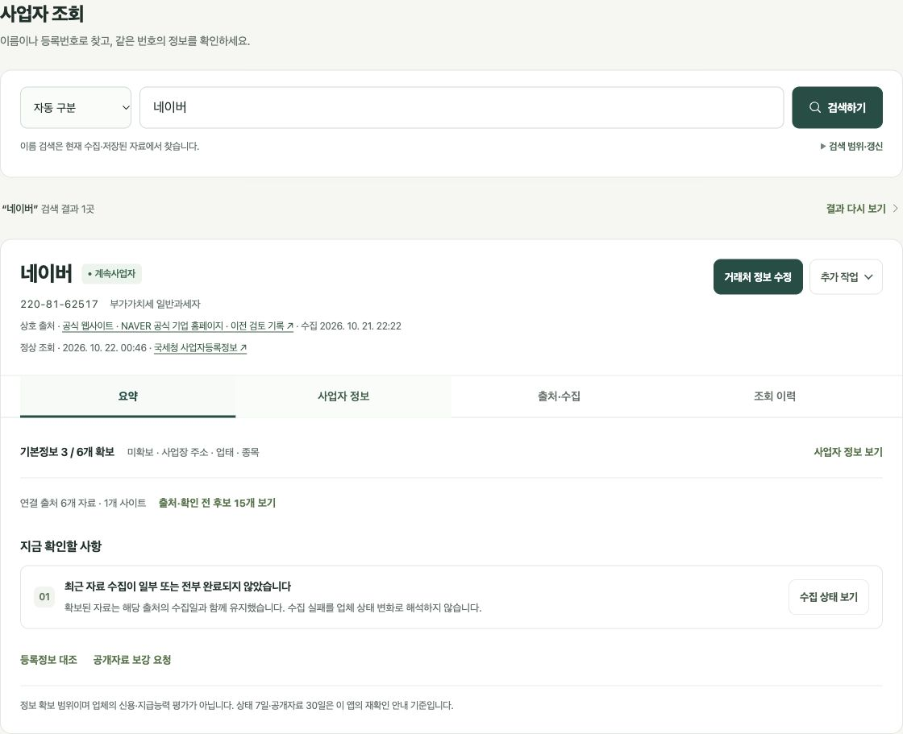
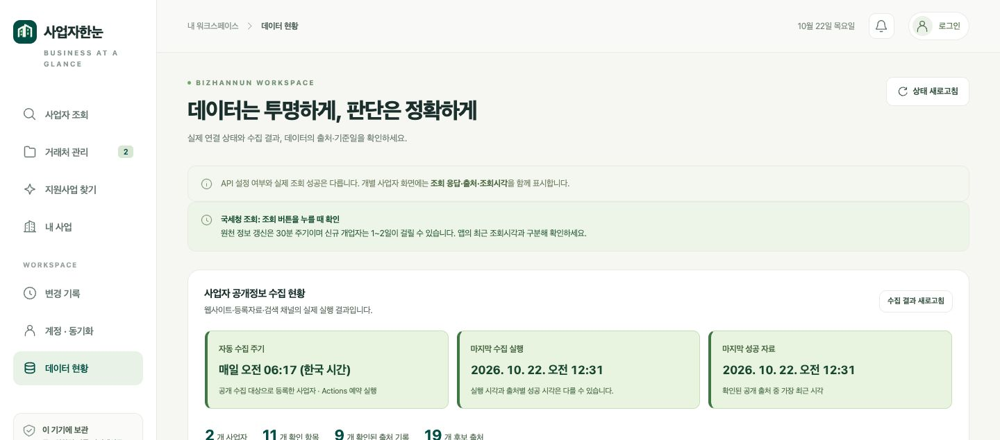
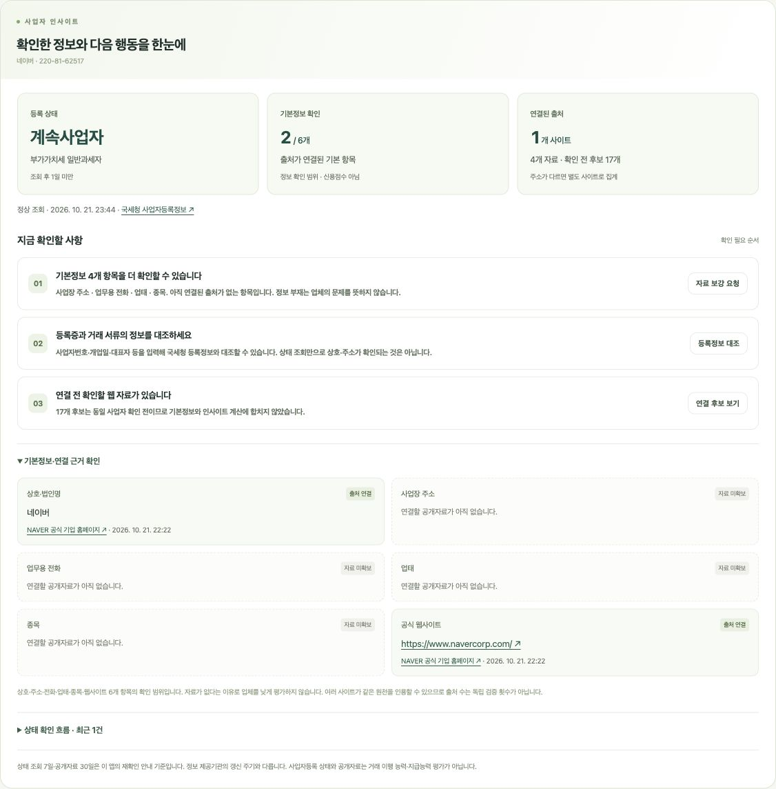
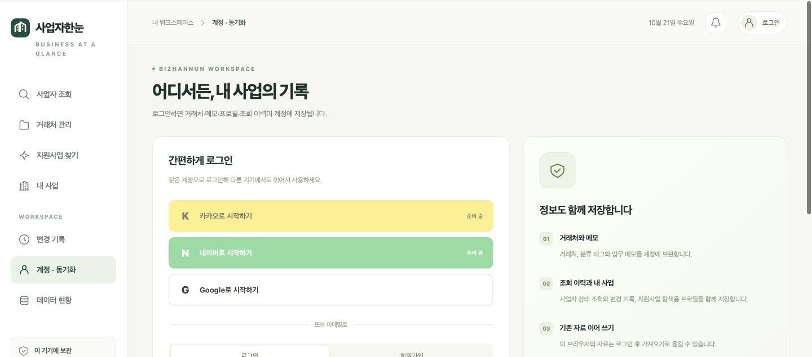
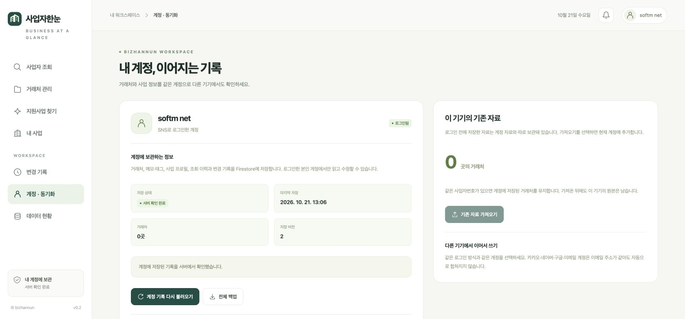
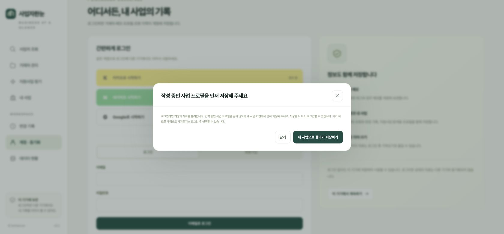
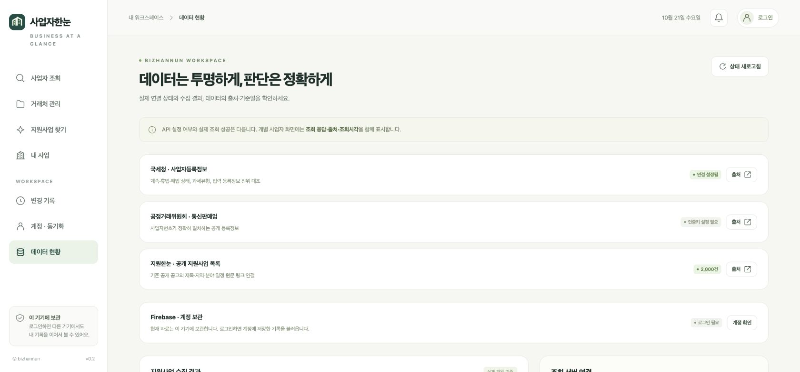
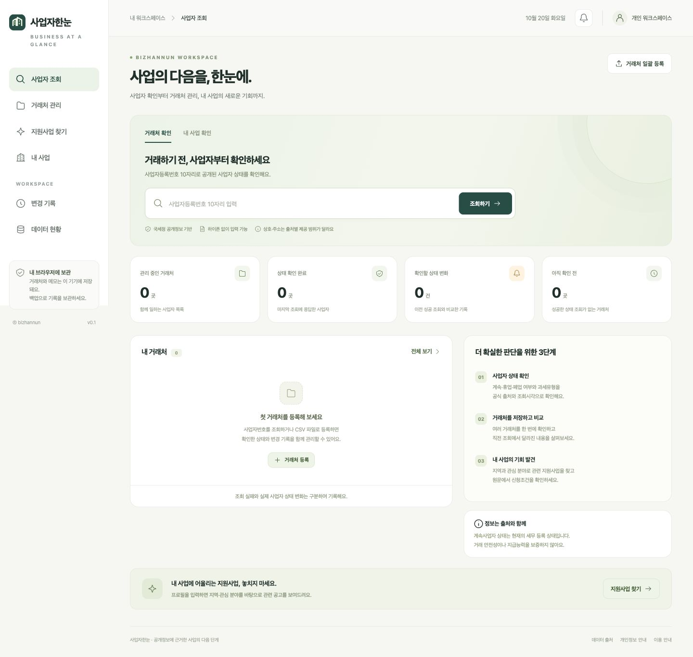
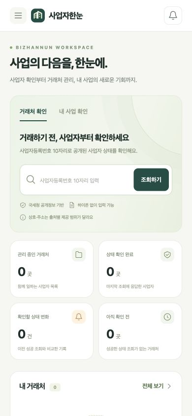

# 구현·배포 검증 기록

## v0.5 검색 중심 화면 개편 — 2026-10-22 한국 시간

구현 커밋 [`dc8e4ed`](https://github.com/softm/bizhannun/commit/dc8e4edf38ee5aa04bd49a7512dc00d5a358d93e)은 [Pages 실행 39628231063](https://github.com/softm/bizhannun/actions/runs/39628231063)의 build·deploy가 모두 성공했다. 기획·화면 상태 검토와 디자인 검토를 분담하고 [검색 화면 설계](SEARCH_EXPERIENCE.md)에 합의한 구조를 기록했다.

### 구현한 구조

- 검색 입력 → 이름 후보 선택 → 한 업체의 상세 카드로 정리했다. 번호 직접 조회는 후보 단계 없이 상세로 연결된다.
- 업체명·번호·상태·과세유형·출처·조회시각과 저장 행동을 한 헤더에 모았다.
- 상세는 `요약 / 사업자 정보 / 출처·수집 / 조회 이력` 네 탭이다. 기본 화면의 확인 사항은 최대 2개이며 나머지는 펼쳐 볼 수 있다.
- 검색 초기에는 짧은 안내와 저장한 거래처 최대 3곳을 표시한다. 전체 거래처 점검·일괄 작업은 거래처 관리에서 제공한다.
- 같은 번호 재조회는 카드·탭·펼침 상태를 유지한다. 다른 번호 조회는 요약에서 시작하며 이전 응답의 혼입을 차단한다.
- 늦게 도착한 응답이 다른 입력·모달·한글 조합 중 초점을 가져가지 않도록 보완했다.
- 병행 배포된 다중 채널 수집·구조화 자료 보관 변경을 보존했다. 자동으로 저장한 공개명은 최신 공개명으로 갱신하고 실제 사용자 별칭과 구분한다.

### 자동 검증

| 검사 | 결과 |
| --- | --- |
| 전체 동작 검사 | 278개 중 **277개 통과, 실패 0개, 건너뜀 1개** |
| 새 상세 렌더러 | 12개: 4탭·ARIA·활성 패널·6개 기본 항목·출처·번호 혼입 차단·HTML/URL 처리·이력 등 |
| 이름 출처 회귀 검사 | 3개 추가: 자동 공개명 갱신, 실제 별칭 보존, 동일성 철회 후 자동명 처리 |
| 소스·자료 구문 | JavaScript 67개, JSON 6개 및 필수 공개 파일 통과 |
| 프로덕션 빌드 | 공개 파일 30개 생성, Actions 배포 성공 |
| 상태 전환 보완 | 같은 번호·다른 번호·탭 바로가기·늦은 이름 응답·모달·IME 초점 보호의 함수 수준 검증 9개 통과 |

로컬 Node.js 24와 Actions Node.js 22의 결과를 확인했다. 건너뛴 1개는 별도 Firestore 에뮬레이터가 필요한 검사다. 이번 화면 변경은 Firestore 보안 규칙을 수정하지 않았다.

### 운영 브라우저 검증

2026-10-22 00:46–00:56 KST의 실제 GitHub Pages 화면에서 다음 흐름을 확인했다.

| 검증 흐름 | 실제 확인 결과 |
| --- | --- |
| 초기 화면 | 검색 입력·안내·저장한 거래처만 표시. 전체 통계·거래처 점검·홍보 배너 없음 |
| `네이버` 이름 검색 | 후보 1곳을 명시적으로 선택한 뒤 번호가 일치하는 상세 표시 |
| 선택 후 기본 화면 | 검색 후보 접힘, 상세 카드 1개, 네 탭 중 요약 선택 |
| 사업자 정보 바로가기 | Enter 실행 후 `사업자 정보` 탭에 초점. 기본 6항목과 미확보 항목·출처 표시 |
| 탭 키보드 조작 | ArrowRight·Home·End로 선택과 초점 이동. 활성 패널 1개만 노출 |
| 수집 상태 바로가기 | `출처·수집` 탭을 열고 원천별 수집 상태에 초점 이동 |
| 결과 다시 보기 → 상세 다시 보기 | 검색어·선택 업체·현재 탭 유지. 정상 조회시각이 같아 불필요한 재조회가 발생하지 않음 |
| 같은 번호를 검색창에서 재제출 | `출처·수집` 탭과 접어 둔 수집 상태 유지. 기존 카드 유지 |
| 다른 번호 직접 조회 | 서해박속낙지전문점의 새 번호로 전환하고 요약 선택 |
| 잘못된 번호 | 검증번호 오류와 입력 위치 표시, 이전 상세 제거 |
| 이름 검색 0건 | 수집·저장된 범위에서 찾지 못했다는 설명과 번호 조회·등록 경로 제공 |
| 거래처 정보 수정 | 같은 번호가 미리 채워진 기존 저장 폼 열림. 검수 중 저장하지 않음 |
| 내 사업으로 입력 | 공개명·번호·출처 자료를 검토 가능한 프로필 초안으로 표시. 검수 중 저장하지 않음 |
| 콘솔 | 운영 검수에서 관찰한 오류 0건 |

네이버의 검수 시점 자료는 기본정보 3/6개, 고유 연결 URL 6개·1개 사이트, 수집기록 7건, 확인 전 후보 15개였다. 요약과 출처 탭에서 집계 단위를 일관되게 표시했다. 마지막 시도·마지막 성공·매일 06:17 한국시간의 정기 수집 일정과 대상 제한도 확인했다. 수집본은 이후 갱신될 수 있다.

### 화면과 반응형

| 관찰 | 개편 전 | 개편 후 |
| --- | --- | --- |
| 네이버 선택 후 중복된 주요 상세 카드 | 상태·인사이트·통합정보 3개 | 한 업체 상세 1개 |
| 1440px 너비에서 기본 조회 화면 전체 길이 | 약 4,292px | 약 1,122px |

길이는 각 검수 시점의 실제 자료를 사용한 레이아웃 관찰값이다. 상세 출처와 이력을 모두 펼친 길이 또는 성능·사용성 실험 수치가 아니다.

- **390 × 844:** 요약·사업자 정보·출처·수집·조회 이력에서 `scrollWidth === innerWidth === 390`. 기본 항목과 출처 목록은 한 열이다.
- **360 × 800:** 요약·사업자 정보·추가 작업 메뉴에서 `scrollWidth === innerWidth === 360`. 네 탭은 모두 한 줄, 높이 48px이며 추가 작업 버튼은 44px이다.
- 검색 입력 글자는 16px이다. 긴 출처 문장과 주소·URL이 카드 안에서 줄바꿈된다.
- 화면 크기 검수 후 기본 1440 × 635 뷰포트로 복원했다. 기획·디자인 담당이 PC와 모바일 캡처를 교차 검토했다.
- 실제 모바일 기기와 브라우저 200% 확대 검수는 이번 브라우저 뷰포트 검사에 포함하지 않았다.

아래 캡처는 공개 네이버 조회 영역만 포함하며 계정 식별자·거래 메모·전체 거래처 목록을 포함하지 않는다.



[390px 모바일 검색 화면](screenshots/search-workspace-mobile-v05.jpg)


## v0.4 다중 채널 수집·구조화 보관 — 2026-10-22 한국 시간

구현 커밋 [`26323b6`](https://github.com/softm/bizhannun/commit/26323b6981221b41c8ac8d1396a1705f17540bb3)은 [Pages 실행 39625419538](https://github.com/softm/bizhannun/actions/runs/39625419538)의 build·deploy가 모두 성공했다. 같은 페이지의 현재·과거 자료를 독립 사이트로 오해하지 않도록 후속 커밋 [`6a7bfc8`](https://github.com/softm/bizhannun/commit/6a7bfc85c7be77fed3cd01981669935b1a84c620)에서 출처 수의 표시 단위를 ‘출처 기록’으로 명확히 했다. 이 변경도 [Pages 실행 39626371141](https://github.com/softm/bizhannun/actions/runs/39626371141)의 build·deploy가 모두 성공했고, 최종 Actions 검사에서 262개 통과·실패 0개·건너뜀 1개를 재확인했다.

### 자동 검증

- 로컬 Node.js 24와 Actions Node.js 22에서 **263개 검사 중 262개 통과·실패 0개·건너뜀 1개**. 건너뛴 항목은 별도 Firestore 에뮬레이터가 필요한 검사다.
- `npm run check`: JavaScript 65개·JSON 6개 및 필수 공개 파일 확인.
- `npm run build`: 공개 파일 29개 생성. `git diff --check` 통과.
- 기존 이름 검색·사업자 인사이트·모바일 표 수정과 병합한 결과를 검사했다.
- Naver·Kakao·FSC·DART 제공자별 응답 검사는 fixture 검사이며, 실제 인증 성공 여부는 아래 운영 수집 기록과 구분한다.

### 운영 화면 검증

| 경로 | 실제 확인 결과 |
| --- | --- |
| 기존 거래처 → 통합 정보 | 상호·번호·상태·기본정보·출처·후보·수집시각 연결 |
| 출처와 함께 거래처에 보관 → 새로고침 | 보관 완료 표시 후 상세 재진입, 출처 자료 표시와 기존 사용자 이름·메모 유지 확인 |
| `서해박속` 이름 검색 → 선택 후 조회 | 동일 번호의 실제 국세청 계속사업자·일반과세자 응답 확인, 2026-10-22 00:28 KST |
| 내 사업으로 입력 | 상호·사업자번호·경기 지역·업종과 출처 자료를 검토 가능한 초안으로 표시. 실제 프로필 저장은 하지 않음 |
| 데이터 현황 | 매일 06:17 KST, 마지막 실행·성공 시각, 사업자별·페이지별 성공/동일성 미확인/활용승인 필요/미설정 사유 표시 |
| 반응형 | 데이터 현황의 390 × 844 뷰포트에서 문서 clientWidth/scrollWidth 모두 390px. 데스크톱 복원 후 모두 1440px |

거래처 보관·새로고침의 운영 검증은 같은 브라우저의 기기 저장 공간에서 수행했다. 이번 검증을 다른 기기·다른 계정의 실제 동기화 검증으로 확대하지 않는다. 새 구조화 자료의 백업·계정 직렬화·동일 번호 검증은 자동 검사에 포함했다. 기존 메모는 별도 사용자 입력으로 보존하며 새 공개자료를 메모 문자열로 추가하지 않는다.

운영 브라우저에서 관찰한 콘솔 오류는 0건이었다. 아래 화면은 최종 배포 후의 데이터 현황이며, 개인 거래 메모나 계정 식별자는 포함하지 않는다.



### 실제 수집 결과와 조건

아래는 **2026-10-22 00:31 KST 최종 수집본**이다. 00:25의 [데이터 커밋 8aad0cb](https://github.com/softm/bizhannun/commit/8aad0cbcfd101b591b751653c7da9e39fe02d8ab)과 비교해 확정 항목·출처·후보 수는 유지됐고 성공 자료와 시도 시각을 갱신했다. 등록된 대상 2곳의 자료이며 전국 사업자 색인이 아니다.

| 사업자 | 확정 항목 종류 | 출처 기록 / 고유 URL | 후보 기록 | 실제 결과 |
| --- | --- | --- | --- | --- |
| 서해박속낙지전문점 | 6종 | 2개 / 1곳 | 4개 | 비즈노에서 사업자번호가 일치하는 상호·업태·종목·주소·전화 5개를 새로 수집. 업종 1개는 이전 검토본의 시각 유지 |
| 네이버 | 5종 | 7개 / 6곳 | 15개 | 공식 메인·연락처·서비스 3페이지 수집. 상호·소개·전화·홈페이지·제품/서비스 자료 연결 |

같은 항목의 다른 원문 값을 포함한 확정 관측은 16건, 후보 출처 기록은 19개다. 과거 기록과 현재 기록이 같은 URL을 가리킬 수 있으므로 출처 기록 수를 독립 검증 사이트 수로 해석하지 않는다.

- 금융위 기업개황과 근로복지공단 산재·고용보험은 실제 요청에서 `not_authorized`를 반환했다. 서비스별 활용승인·키 확인이 필요하다.
- 공정위·DART·네이버 뉴스/블로그/지역 검색·카카오 장소는 인증값 미설정이다. 연결 코드와 예약 수집은 구현됐지만 이 채널들의 실제 자료 확보를 주장하지 않는다.
- 관광공사·블로그 페이지는 동일 사업자임이 확정되지 않아 후보로 보관했다.
- Instagram·네이버 쇼핑센터는 `robots_unavailable`, Bing RSS는 `robots_disallowed`로 본문 수집을 완료하지 않았다.
- 두 사업자 모두 전체 수집 상태는 `partial`이다. 지원사업의 별도 `collection-status.json` 성공을 사업자 제공자 전체의 성공으로 표시하지 않는다.

아래 이전 검증 절의 비즈노 `unsupported_encoding`은 해당 시점의 이력이다. 이번 운영 수집에서는 robots 주석 처리·문자 디코딩 보완 후 실제 비즈노 5개 항목 수집 성공을 확인했다. 이후 사이트 응답이나 허용 정책이 바뀌면 실패 원인과 이전 성공 자료의 시각을 유지한다.

## v0.4 정보 연결·사업자 인사이트 — 2026-10-21

현재 운영은 [GitHub Pages](https://softm.github.io/bizhannun/)와 GitHub Actions 자동 수집·배포를 사용한다. 국세청 상태·진위확인은 기존 브라우저 직접 조회 방식을 유지한다. 이번 변경은 별도 Vercel 배포나 Firestore 규칙·저장 스키마 변경을 포함하지 않는다. 아래 v0.1·v0.2 기록의 Vercel 관련 설명은 당시 검증 이력이다.

기획·정보 모델·행동 우선순위는 [BUSINESS_INSIGHTS.md](BUSINESS_INSIGHTS.md)에 정리했다.

| 변경 | 검증한 범위 |
| --- | --- |
| 사업자번호 기반 공통 표시 모델 | 저장한 이름이 비어 있으면 동일 번호의 공개 상호 표시, 사용자 별칭 보존, 다른 번호의 응답·출처 차단 |
| 화면 간 연결 | 조회·목록·상세·검색·내보내기·점검 필터에서 공통 모델 사용, 상세창 버튼의 대상 번호 전달 |
| 사업자 인사이트 | 상태 재확인, 기본정보 6항목 확보 범위, 출처별 값 차이, 후보·미확보·과거 자료 구분, 최근 조회 이력 |
| CSV 보존 | 사용자 이름·별칭과 공개 상호 보조 열을 분리, 재가져오기로 공개 상호가 사용자 별칭이 되지 않음 |
| 공개 웹 수집 | 다른 업체의 표·복수 JSON-LD 조직 오결합 차단, 부분 수집 시 이전 성공 자료와 시각 보존 |
| 전송·문자 처리 | 제한 크기를 적용한 gzip·deflate·br 해제, 선언된 EUC-KR 및 지원되는 CP949 공통 영역 디코딩, 손상 문서 거부 |
| 수집 현황 | 매일 06:17 KST 예약, 마지막 시도·성공 시각 구분, 대상 범위와 미승인·미설정 제공자 표시 |

배포 전 로컬 확인: `npm run check` 통과(JavaScript 59개, JSON 6개), `npm test`의 19개 파일 통과, `npm run build` 통과(공개 파일 28개), `git diff --check` 통과. 최종 19개 테스트 파일을 각각 직접 실행해 **210개 중 209개 통과, 실패 0개, Firestore 에뮬레이터 검사 1개 건너뜀**을 확인했다. 이번 변경에서 Firestore 규칙과 저장 스키마는 수정하지 않았다.

배포 준비 중 추가된 상호 검색 변경(`fc68c631`)을 보존해 통합했다. 이름 검색·번호 조회·목록·상세가 하나의 검증된 공개자료 캐시를 공유하며, 개인 거래처·프로필은 현재 계정 자료로 색인을 구성한다.

개별 수집 사이트의 운영 네트워크 응답 복구는 로컬 fixture 검사와 구분한다. 로컬 환경에서는 대상 호스트 DNS 조회가 실패했으므로 실제 사이트의 인코딩 복구를 확인했다고 기록하지 않는다. 전체 CP949 확장 문자 지원도 보장하지 않으며 손상된 내용은 새 정보로 승격하지 않는다.

### 운영 화면 확인

정보 연결·인사이트의 최초 배포는 [Pages 실행 39616191320](https://github.com/softm/bizhannun/actions/runs/39616191320), 모바일 표 폭 수정은 [Pages 실행 39617890353](https://github.com/softm/bizhannun/actions/runs/39617890353)에서 성공했다. 최종 출처 차이 경고 보완 커밋 `8869655a`는 [Pages 실행 39619152173](https://github.com/softm/bizhannun/actions/runs/39619152173)의 build·deploy 모두 성공했다. 이 실행의 Node.js 22 검사 로그에서도 210개 중 209개 통과·실패 0개·건너뜀 1개를 확인했다. 다음 항목은 실제 GitHub Pages 운영 화면에서 확인했다.

| 경로 | 실제 확인 결과 |
| --- | --- |
| 거래처 목록 → 상세 | 서해박속낙지전문점의 동일 사업자번호로 등록 상태·기본정보 5/6개·공개자료·개인 메모·조회 이력 연결 |
| 공개 상호 대체 표시 | 빈 이름 fixture와 실제 공개 수집본을 결합해 동일 상호 표시, 원래 저장 이름은 빈 값 유지. 운영에 이미 입력된 이름은 사용자 입력으로 표시 |
| 거래처 검색·점검 | 공개 주소의 `광명` 검색과 `기본정보 보강` 카드 필터가 해당 거래처 1곳을 표시 |
| 상호 검색 → 조회 | `네이버` 결과 선택이 `220-81-62517` 국세청 상태 조회로 연결되어 계속사업자·일반과세자 실제 응답 표시 |
| 인사이트 행동 | 수집 상태 보기·출처 차이 확인·등록정보 대조가 해당 번호의 정보와 대조창을 열었으며 대조창 제출이나 거래처 추가 저장은 하지 않음 |
| 수집 현황 | 매일 06:17 KST 예약, 마지막 시도와 실제 성공 시각, 대상 업체 2곳, 제공자별 미승인·미설정 상태 표시 |
| 모바일 390 × 844 | 목록의 document clientWidth/scrollWidth가 모두 390px. 상세창 폭 366px, 내부 scrollWidth 364px로 화면 안에 표시. 확인 후 화면 크기 설정 복원 |

회사소개·연혁 등 문구 차이는 비교 조건이 같지 않으므로 우선 경고에서 제외했다. 상호·주소·연락처 등 명시된 비교 항목의 차이만 행동 안내와 거래처 점검 건수에 포함하며, 제외 항목의 원문·대체 값은 보존한다. 회귀 검사로 이 동작을 확인했다. 최종 배포 후 23:44 KST에 운영 사이트의 `네이버` 상호 검색 결과를 선택해 계속사업자·일반과세자 응답, 기본정보 2/6개, 출처 차이 우선 경고 없음, 기존 회사소개 대체 값 보존을 확인했다. 이 확인에서 수집된 브라우저 콘솔 오류는 0건이었다.

아래는 공개 네이버 조회 결과의 인사이트 영역이다. 개인 거래처 목록·계정 정보·메모는 포함하지 않는다.



### 실제 공개자료 범위와 남은 조건

현재 등록된 공개 보강정보 대상은 2곳이다. 이는 전국 사업체 전체를 수집한 색인이 아니다. 서해박속낙지전문점의 Bizno 재수집은 운영에서 `unsupported_encoding`으로 실패하고 있으며, 마지막 성공 시각인 **2026-10-21 22:22:53 KST**의 상호·주소·전화·업태·종목·업종 6개 사실을 유지한다. 기본정보 6개 중 웹사이트를 제외한 5개가 확보되어 있다는 표시와 구분한다.

근로복지공단 산재·고용보험은 `not_authorized`, 공정위 통신판매업은 `not_configured` 상태다. 활용승인·인증키 조건이 충족되었다고 표시하지 않는다. `data/collection-status.json`의 성공은 지원사업 수집 작업의 결과이며, 사업자별 보강정보·모든 제공자의 성공을 의미하지 않는다.

## 이전 배포 검증 기록

v0.1 초기 검증: 2026-10-20. v0.2 로그인·계정 보관 추가 기록: 2026-10-21, 한국 시간 기준. 구현, 인프라 생성, 운영 설정, 실제 계정 검증을 구분합니다.

## v0.2 당시 운영 주소

- 화면: [사업자한눈](https://softm.github.io/bizhannun/)
- 데이터 현황: [data-status.html](https://softm.github.io/bizhannun/data-status.html)
- 기관 API 상태: [/api/health](https://bizhannun.vercel.app/api/health)
- 로그인 공개 설정: [/api/config](https://bizhannun.vercel.app/api/config)
- Firebase 프로젝트: [biz-hannun](https://console.firebase.google.com/project/biz-hannun/overview)
- 로그인 제공자: [Authentication](https://console.firebase.google.com/project/biz-hannun/authentication/providers)
- 데이터베이스: [Firestore](https://console.firebase.google.com/project/biz-hannun/firestore)에서 `bizhannun` 선택

## v0.2 당시 확인 상태

| 항목 | 확인된 내용 | 남은 검증 |
| --- | --- | --- |
| Firebase 프로젝트 | `biz-hannun`, 표시 이름 Biz Hannun, Spark 플랜 생성 확인 | 운영 사용량 점검 |
| Firebase 웹 앱·공개 API | `bizhannun-web` 구성; 후속 `/api/config` HTTP 200·Pages CORS 허용, Google·email `configured: true`, kakao·naver `false` 확인 | 카카오·네이버 인증값 등록 후 실제 인증 |
| Firestore 데이터베이스 | Enterprise Native `bizhannun`, `asia-northeast3`, 실시간 기능·보안 규칙 게시; 운영 저장 직후 성공 표시·새로고침 복원 및 최종 revision 4 확인 | 다른 물리 기기에서 재조회 |
| 구글 로그인 | 같은 Chrome의 Pages·Vercel 두 origin에서 Google 로그인 성공; Pages 재로그인과 별도 origin의 동일 계정 자료 복원 확인 | 다른 물리 기기에서 동일 계정 인증·조회 |
| 이메일 로그인 | Console 제공자 활성화, 가입·로그인·재설정·인증 메일 UI와 클라이언트 구현·자동 검사 | 실제 이메일 가입·메일 수신 확인 |
| 승인된 도메인 | `softm.github.io`, `bizhannun.vercel.app` 등록; 두 origin에서 Google 인증 성공 | 별도 도메인 추가 시 재확인 |
| 계정 분리 정책 | Console의 `ID 공급업체별로 여러 계정 만들기` 저장; 이메일 자동 병합 없음; 에뮬레이터에서 다른 UID 접근 거부 | 다른 실제 계정·다른 물리 기기 간 검증 |
| 카카오·네이버 로그인 | OAuth 서버·상태 쿠키·제공자 확인·Custom Token 구현; SNS 인증 설정 중 Production `AUTH_SESSION_SECRET` 등록 확인 | 앱 인증값·Firebase Admin 설정 및 실제 인증 |
| 계정 정보 저장 | 운영 프로필 저장·새로고침·별도 origin 복원 확인; 다른 앱 인스턴스의 변경 안내와 최신 기록 불러오기 확인; 테스트 사업체명을 빈 값으로 정리하고 revision 4 저장 성공 | 실제 거래처·메모·조회 이력의 운영 저장 검증 |
| 기존 기기 자료 이전 | Vercel에서 명시적 가져오기 후 revision 3 저장 성공, 계정의 기존 프로필 유지, 로그아웃 후 기기 프로필 원문 복원 확인 | 거래처 0곳으로 시험했으므로 실제 거래처·사업자번호 중복 사례는 미검증 |
| 미저장 프로필 보호 | Vercel 비로그인 공간에서 Google 로그인 전 안내, 내 사업으로 돌아온 뒤 입력 보존, 프로필 저장 후 인증 팝업 시작 확인 | 이메일 가입·로그인 등 미검증 인증 흐름은 별도 확인 |
| v0.2 배포 | 커밋 `6194f8f`의 Pages Actions `39542201349` completed/success, 양쪽 공개 모듈의 로그인 전 가드 확인; 국세청 설정 후 최신 Vercel `dpl_5RrCBZX3GAWbpiXMqm5NJ9hPvjru` READY·운영 alias 확인 | — |
| 국세청 상태 조회 | Production `NTS_SERVICE_KEY` sensitive 등록·재배포; 2026-10-21 15:21 한국 시간에 실제 `/api/status` 성공 응답과 Pages의 사업자 상태·과세유형 표시 확인 | 진위 대조·대량 조회의 실제 운영 검증 |
| 공정위 통신판매 조회 | `FTC_SERVICE_KEY` 미설정; `configuration: missing_key`·`authentication: not_checked` | Production 키 등록·재배포 후 실제 기관 응답 확인 |

Firestore Console에서 `bizhannun` 규칙 게시와 새 활성 버전을 확인했습니다. 게시 규칙의 SHA-256은 `32b7854f24bd2a9f28ff7f34fce12730bdeb619a9127a9d69b8b2239c1a8479b`입니다. 규칙 게시, 에뮬레이터 시험, 실제 계정 시험의 범위를 구분합니다.

## v0.2 운영 브라우저·API 확인

2026-10-21 한국 시간의 최초 운영 확인에서 다음 동작을 실제 운영 주소에서 확인했습니다.

- 로그인 설정을 다시 불러오자 Google 버튼과 이메일 폼이 활성화됐습니다. 인증값이 없는 카카오·네이버는 `준비 중`으로 표시됐습니다.
- Google 팝업에서 계정을 선택한 뒤 운영 앱의 `로그인됨`과 `계정 저장소 연결됨`, 저장 버전 0을 확인했습니다.
- 비어 있던 내 사업 프로필에 검증용 문구만 입력하고 저장했습니다. 실제 Firestore 커밋은 성공했지만 저장 직후 확인 과정에서 충돌 안내가 표시됐습니다.
- `계정 기록 다시 불러오기`를 실행하자 저장 버전 1, 마지막 저장 시각, `서버 확인 완료`가 표시됐습니다. 서버 저장과 재조회가 성공했음을 확인했습니다.
- 로그아웃 후 계정 자료가 화면에서 제거되고 비로그인 공간·로그인 폼으로 돌아오는 것을 확인했습니다.
- 쿠키 없이 호출한 `/api/config`와 `/api/health`가 HTTP 200을 반환하고 `Access-Control-Allow-Origin: https://softm.github.io`를 제공했습니다.

위 확인 직후에는 브라우저 연결이 끊겨 수정 배포 후의 재로그인·새로고침·다른 기기 조회를 추가 확인하지 못했습니다. 이는 당시 검증의 제한이며, 이후 확인한 범위는 아래 후속 운영 검증에 구분해 기록합니다. 이 시점에는 이메일 가입·메일 수신, 카카오·네이버 실제 로그인, 국세청 원천 인증 성공을 확인하지 못했습니다. 국세청의 이후 연결 성공은 별도 절에 기록합니다.

### 로그인 화면

아래는 v0.2 운영 Pages의 실제 로그인 화면입니다. Google은 활성 상태이며 카카오·네이버의 설정 대기를 함께 표시합니다.



### 저장 직후 확인 보완

실제 운영에서 커밋 후 재조회에는 성공했지만 저장 직후 확인에서 충돌로 표시되는 경합을 발견했습니다. 설치된 Firebase SDK의 `getDocFromServer`가 기존 실시간 listener의 마지막 서버 스냅샷을 이용하는 경로를 확인했습니다. 이전 head를 반환하는 조건을 강제로 재현한 시험은 수정 전 저장 후 `cloud/conflict`로 실패했고, 수정 후 통과했습니다. 운영 서버의 스트림 순서를 직접 계측한 것은 아니므로 이 재현 시험과 실제 운영 관찰을 구분합니다.

변경 가능한 head를 읽기 전용 `runTransaction(transaction.get)`으로 확인하도록 수정했습니다. 실제 더 높은 revision은 계속 충돌로 처리하며, 커밋 후 최신 head를 확인하지 못하면 `cloud/confirmation-pending`으로 안내하고 커밋한 자료를 보존합니다. Rules나 저장 스키마는 변경하지 않았습니다. 저장 어댑터 **16/16**, 실제 Firebase SDK와 Enterprise 에뮬레이터 **8/8**이 통과했습니다. `check`·기본 테스트·`build`·`git diff --check`도 통과했습니다. 이 수정 직후에는 연결 상실로 운영 브라우저 재검증을 완료하지 못했으며, 이후 저장 성공 표시를 확인한 결과를 다음 절에 기록합니다.

수정 커밋은 [`81cd1c1`](https://github.com/softm/bizhannun/commit/81cd1c12eaeaf5a046840883d64569c3f8845dcc)이며, [당시 Pages 배포 실행](https://github.com/softm/bizhannun/actions/runs/39513872679)의 build·deploy가 모두 성공했습니다. 당시 Vercel 배포 `dpl_HCF4kEu78nQGDhgxWJf8SVUgqPDN`의 READY 상태와 `bizhannun.vercel.app` 연결을 확인했습니다. 양쪽 공개 HTML에서 실제 모듈 URL을 따라가 저장 확인 로직과 프로필 보관 안내 문구를 확인했습니다. 운영 `/api/config`와 `/api/health`도 HTTP 200·Pages CORS 허용을 다시 확인했습니다. 국세청·공정위 키와 카카오·네이버 서버 인증값은 여전히 설정 대기였습니다.

### 2026-10-21 후속 운영 검증

한국 시간 2026-10-21에 실제 브라우저에서 다음 범위를 추가 확인했습니다. Pages와 Vercel은 **같은 Chrome의 서로 다른 origin**에서 실행했습니다. 서로 다른 물리 기기나 서로 다른 실제 계정을 사용한 시험은 아닙니다.

1. Pages 운영 앱에서 Google로 다시 로그인하자 기존에 저장한 revision 1의 프로필이 복원됐습니다.
2. 테스트 사업체명만 `Firestore 저장·복원 검증용 · 테스트`로 변경해 저장했습니다. 저장 직후 `서버 확인 완료`와 저장 버전 2가 표시됐습니다.
3. Pages를 새로고침한 뒤 동일한 테스트 사업체명이 복원되는 것을 확인했습니다.
4. Vercel의 별도 origin에서 비로그인 상태로 사업 프로필을 입력한 다음 Google 로그인을 눌렀습니다. `작성 중인 사업 프로필을 먼저 저장해 주세요` 안내가 표시됐고, `내 사업으로 돌아가 저장하기`를 누르자 입력이 그대로 유지됐습니다. 프로필을 기기에 저장한 후에는 Google 인증 팝업이 정상적으로 시작됐습니다.
5. Vercel origin에서도 Google 로그인을 완료했습니다. 서버의 revision 2와 Pages에서 저장한 `Firestore 저장·복원 검증용 · 테스트` 프로필이 동일하게 복원됐습니다.
6. Vercel 기기 공간에 `로그인 전 기기 저장 검증용 · 테스트` 프로필이 있는 상태에서 명시적 가져오기를 실행했습니다. `서버 확인 완료`와 revision 3을 확인했으며, 계정의 기존 프로필을 유지했습니다. 이 시험의 거래처는 0곳이므로 실제 거래처 추가나 사업자번호 중복 사례를 검증한 것으로 보지 않습니다.
7. Vercel에서 로그아웃하자 기기의 `로그인 전 기기 저장 검증용 · 테스트` 프로필 원문이 그대로 복원됐습니다. 원본 보존을 확인한 뒤 기기 테스트 사업체명을 빈 값으로 저장했고, 페이지를 새로고침한 후에도 빈 값으로 유지되는 것을 확인했습니다.
8. Pages의 다른 앱 인스턴스에 `다른 기기에서 기록이 변경되었습니다`라는 안내가 표시됐습니다. `최신 기록 확인`을 눌러 계정의 최신 기록을 정상적으로 불러왔습니다. 안내 문구에 “다른 기기”가 포함되지만, 실제 확인한 대상은 같은 Chrome의 별도 origin입니다.
9. 마지막으로 Pages 계정의 테스트 사업체명을 빈 값으로 저장해 정리했고, `서버 확인 완료`와 저장 버전 4를 확인했습니다.

아래 이미지는 Pages에서 revision 2를 저장한 **당시의 확인 화면**입니다. 이후 가져오기와 테스트 사업체명 정리까지 마친 최종 확인 버전은 revision 4입니다.



Vercel에서 확인한 미저장 프로필 로그인 안내:



이 프로필 보호 후속 배포의 코드 커밋은 [`6194f8f`](https://github.com/softm/bizhannun/commit/6194f8f8756637e3d7cd17e11f5d72315e6c9970)입니다. [Pages 실행 `39542201349`](https://github.com/softm/bizhannun/actions/runs/39542201349)은 completed/success이며, 당시 Vercel 배포 `dpl_6kocPJjMKx5CXjjxAcva1WHVLLpN`의 READY 상태와 `bizhannun.vercel.app` 연결도 확인했습니다. 두 공개 앱 HTML이 참조하는 실제 module URL을 따라가 `blockLoginForProfileDraft`와 한국어 안내 문구가 양쪽 모두 포함된 것을 HTTP로 확인했습니다.

국세청 키 등록 전의 후속 `/api/config`와 `/api/health` 요청은 각각 HTTP 200을 반환했고 Pages origin의 CORS를 허용했습니다. 공개 설정은 Google·email의 `configured: true`, kakao·naver의 `configured: false`를 반환했습니다. 당시 기관 상태는 국세청·공정위 모두 `configuration: missing_key`, `authentication: not_checked`였습니다. 제공자 설정 플래그를 실제 이메일·SNS 로그인 성공으로 해석하지 않습니다.

이 시점의 Vercel 환경변수 메타데이터에는 Production `AUTH_SESSION_SECRET`만 등록되어 있었습니다. 국세청·공정위 키, 카카오·네이버 앱 인증값, Firebase Admin 서비스 계정은 당시 미설정 상태였습니다. 이 확인은 비밀값 자체나 원천 서비스의 인증 성공을 검사한 결과가 아닙니다. 이후 국세청 키 등록과 실제 조회 결과는 다음 절에 기록합니다.

Vercel 별도 origin에서의 Google 로그인·계정 자료 조회·명시적 가져오기·로그아웃 후 기기 원본 복원을 확인했습니다. 기기와 계정의 테스트 사업체명은 모두 빈 값으로 정리 완료했습니다. 기존 저장 버전이나 기록 전체를 삭제한 것은 아닙니다. 확인 범위는 프로필 중심이며 실제 거래처의 사업자번호 중복 사례는 포함하지 않습니다. 이메일 가입·메일 수신, 카카오·네이버 실제 로그인, 다른 물리 기기, 다른 실제 계정의 분리는 아직 검증하지 않았습니다.

### 2026-10-21 15:21 국세청 운영 연결 확인

한국 시간 2026-10-21 15:21에 기존 Pages 사용자 탭에서 실제 단건 상태 조회를 완료했습니다. 확인 과정은 다음과 같습니다.

1. 공공데이터포털의 해당 국세청 서비스에서 기존 활용 승인을 확인했습니다. 활용신청이 되어 있었지만 앱 서버의 인증키 등록이 빠져 있던 상태였습니다.
2. 발급된 일반 인증키를 Vercel Production `NTS_SERVICE_KEY`에 sensitive 유형으로 등록했습니다.
3. 재배포 `dpl_5RrCBZX3GAWbpiXMqm5NJ9hPvjru`의 READY 상태와 공개 운영 alias `bizhannun.vercel.app` 연결을 확인했습니다.
4. 운영 `/api/health`에서 국세청 `configured: true`를 확인했습니다. 상태 점검은 키 존재 여부만 확인하므로 `authentication: not_checked`와 실제 인증 성공을 구분합니다.
5. 실제 `/api/status` 요청에서 `outcome: ok`와 사업자 상태·과세유형 등 원천 응답을 받았습니다. 단순 HTTP 200이나 키 존재 확인으로 성공을 판단하지 않았습니다.
6. 기존 Pages 탭의 `조회하기`를 눌러 계속사업자 상태와 과세유형이 화면에 표시되는 것까지 확인했습니다.

공개 기록에는 조회에 사용한 실제 사업자번호, 사용자 개인정보, 인증키, 개별 조회 결과 화면을 추가하지 않았습니다. 이번 운영 검증은 단건 상태 조회 범위이며, 등록정보 진위 대조·대량 조회·조회 결과의 계정 저장까지 검증한 것으로 확대하지 않습니다. 공정위 `FTC_SERVICE_KEY`, 카카오·네이버 앱 인증값과 Firebase Admin 서비스 계정은 계속 설정 대기입니다.

아래는 개인 조회 정보가 없는 Pages 데이터 현황 화면입니다. 국세청의 `연결 설정됨`과 공정위의 `인증키 설정 필요`를 보여 주며, 실제 단건 조회 성공은 위 API·조회 화면 검증으로 별도 확인했습니다.



## v0.2 자동 검사 범위

| 영역 | 검사 내용 |
| --- | --- |
| 인증 클라이언트 | 공개 설정 allowlist, 오류 메시지 정규화, 팝업 origin·source·nonce·provider 확인, 계정 전환 |
| SNS 서버 | 서명된 상태 쿠키의 위조·만료·중복 거부, 정확한 origin, 제공자 토큰·사용자 검증, 비밀값 유출 방지 |
| 공개 설정 API | private 필드 제거, 잘못된 JSON 거부, CORS, 명명된 DB, Admin/Web 프로젝트 일치 |
| 계정 저장 | 저장 버전 충돌, 분할 기록·무결성, 다른 UID로 전환 중인 요청 차단, 게스트 이전·중복 처리 |
| Firestore 규칙 | 미로그인·다른 UID 접근 차단, 문서 구조·소유자 검증, 변경 불가능한 조각과 순차 저장 버전 |

로컬 `npm run check`, `npm test`, `npm run build`가 통과했습니다. SNS 서버 테스트 13개와 공개 설정 테스트 9개는 각각 직접 실행해서도 모두 통과했습니다. 저장 어댑터 테스트 16개와 공식 Enterprise 에뮬레이터를 이용한 Firestore 실제 SDK·규칙 검사 8개 중 8개 통과 기록을 확보했습니다. fixture 및 에뮬레이터 결과는 실제 제공자 로그인·운영 데이터베이스 저장의 성공을 뜻하지 않습니다.

```bash
npm ci
npm run check
npm test
npm run test:rules
npm run build
```

## v0.1 자동 검사 기록

`npm run check`, `npm test`, `npm run build`가 로컬과 GitHub Actions에서 통과했습니다. 테스트 파일은 도메인 규칙, 기관 API, 지원사업, 저장·복원의 네 영역으로 구성합니다.

사업자번호 검증번호, CSV의 따옴표·개행·중복·오류·수식 삽입 방어, 같은 사업자와 출처의 성공 응답 비교, 늦게 도착한 응답과 실패 응답 처리, 잘못된 백업의 중첩 구조, 사업자번호 불일치, 원천 요청 크기 제한, CORS, 기관 오류 처리와 출처 보존을 검사합니다. 기관 응답 테스트는 제어된 fixture를 사용하며 실제 인증 조회가 아닙니다.

## v0.1 공개 서버 확인

v0.1 초기 검증 당시 운영 Production 도메인에 로그인 쿠키 없이 요청했습니다. 아래 `not_configured`와 인증키 미설정 결과는 국세청 키 등록 전의 기록입니다.

| 확인 | 결과 |
| --- | --- |
| `GET /api/health` | HTTP 200 JSON, 서비스 배포 상태 확인 |
| Pages origin의 CORS | `https://softm.github.io`를 명시적으로 허용 |
| 올바른 번호 형식의 상태 요청 | HTTP 200, `not_configured`를 명시 |
| 잘못된 번호 형식의 상태 요청 | HTTP 400, `invalid_input` |
| 국세청·공정위 인증키 | 미설정; 실제 기관 인증 성공을 검증하지 않음 |

Vercel의 기본 배포 보호는 유지했습니다. 공개 운영 도메인은 `bizhannun.vercel.app`이며 팀 alias와 개별 배포 주소는 보호될 수 있습니다.

## v0.1 실제 브라우저 확인

- 잘못된 사업자번호에 대한 입력 오류 안내를 확인했습니다.
- 유효한 형식의 번호를 조회하면 인증키 미설정을 사업자 폐업이나 조회 성공으로 표시하지 않습니다.
- 임시 거래처에 태그·메모를 저장하고 새로고침 후 유지되는 것을 확인했습니다. 검증용 임시 거래처는 정리했습니다.
- CSV 미리보기에서 신규 1건, 기존 거래처 1건, 잘못된 행 1건을 구분하는 것을 확인했습니다.
- 지원사업 검색과 조건 확인 창, 원문 링크와 추가 확인 사항을 확인했습니다.
- Pages의 데이터 현황 화면에 2,000건, 원천 39,987건, 선정 범위와 기업마당 원천 기준일이 표시되는 것을 확인했습니다.
- 390 × 844 모바일 화면에서 메뉴 탐색과 조회 화면을 확인했습니다. 문서 너비와 스크롤 너비가 모두 390px로 가로 넘침이 없었습니다. 검증 후 화면 크기 설정은 원래대로 복원했습니다.
- 전국 대상 공고의 카드가 일부 지역만 표시하지 않도록 지역 요약을 개선했습니다.
- 배포 후 오래된 브라우저 모듈이 재사용되는 현상을 확인해 빌드 시 CSS·설정·전체 브라우저 모듈에 같은 콘텐츠 버전을 적용했습니다.

## 공개 데이터 범위

지원한눈 manifest와 gzip 목록의 파일 크기, SHA-256, 공고 건수를 검증했습니다. 원천 39,987건 중 미종료 공고 우선·게시일 순서로 최대 2,000건을 연결합니다. 초기 수집에서 메타데이터 불량 2건, 선택 상한 37,985건을 구분했습니다. 모든 원천 공고를 제공하는 화면은 아닙니다.

원천 전체 목록의 갱신 시각은 2026-10-20T00:27:06.298Z였습니다. 기업마당 부분은 원천의 인증키 미설정 안내에 따라 2026-10-12T12:17:48.234Z의 이전 성공 자료를 사용합니다. 앱의 수집 시각과 원천 자료의 갱신 시각을 구분해서 표시합니다.

## 초기 화면 기록

아래 이미지는 v0.1 초기 배포 화면입니다. v0.2 로그인·동기화 화면의 검증 증거로 사용하지 않습니다.

### 데스크톱



### 모바일



## v0.2 당시 운영 범위

v0.2는 Firebase UID별 업무 정보 보관과 로그인 전 기기 자료의 명시적 이전을 구현합니다. 비로그인 IndexedDB 공간을 유지하고 계정 자료와 분리합니다. 원격 변경을 감지하면 최신 기록을 불러오도록 안내하며 충돌을 무조건 덮어쓰지 않습니다. 팀 공동 작업, SNS 계정 자동 병합, 백그라운드 거래처 모니터링은 포함되지 않습니다.

국세청 상태 조회는 Production 인증키 등록·재배포와 실제 단건 API 응답·Pages 화면 확인을 완료했습니다. 공정위 원천 조회는 아직 인증키 설정과 실제 응답 확인이 필요합니다. 활용신청만으로 Vercel에 인증키가 등록되는 것은 아닙니다. 새 환경 구성·키 교체 시에는 [AUTH_SETUP.md](AUTH_SETUP.md)의 등록·재배포·실제 조회 확인 절차를 따릅니다.

Pages 공개 목록 수집·배포는 매일 한국 시간 06:17로 예약되어 있습니다. Vercel은 소스 직접 배포 방식이며 GitHub App 연동이 없어 Git push만으로 API가 갱신되지는 않습니다. Firestore 규칙 역시 Pages 배포와 별도로 대상 데이터베이스에 적용합니다.
